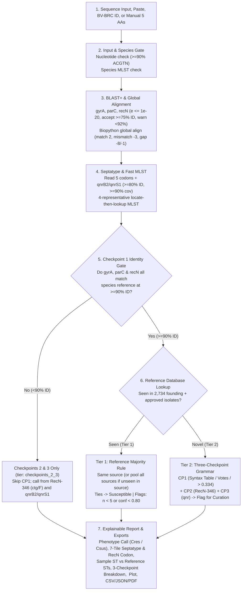
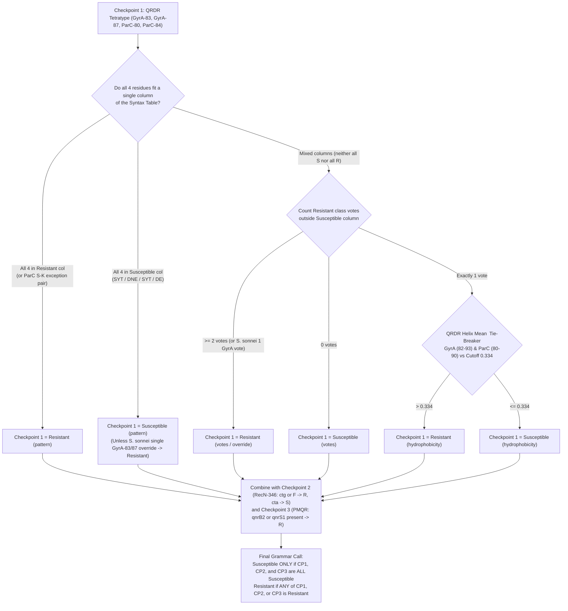
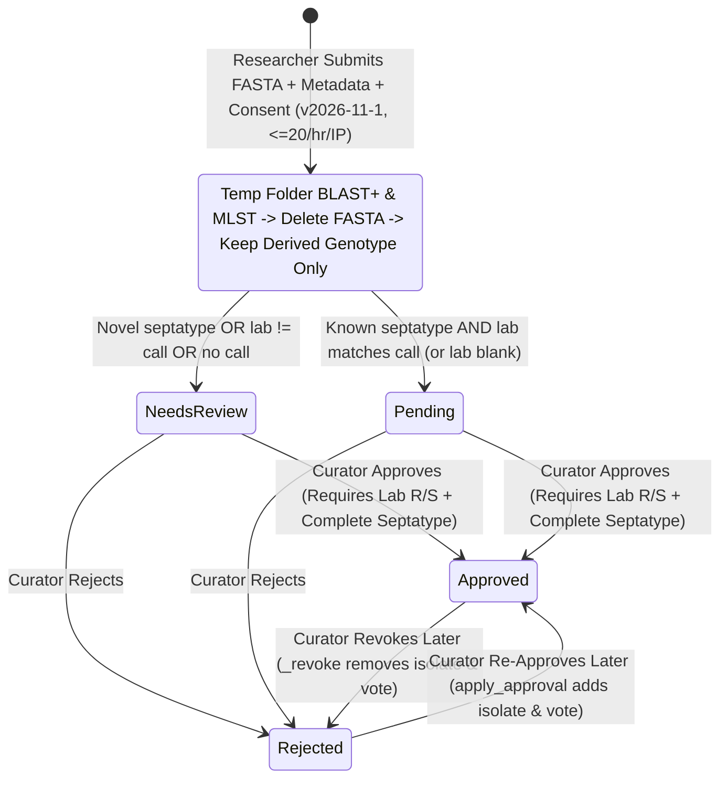

# CiproTyper: Database, Curated Repository for Ciprofloxacin Resistance Prediction in Enterobacterales

**Live Web Server:** <https://septatyper-is.onrender.com/>

**Interactive OpenAPI Documentation:** [https://septatyper-is.onrender.com/docs](https://www.google.com/search?q=https://septatyper-is.onrender.com/docs)

**Source Code Repository:** <https://github.com/ikbalsk/Septatyper>

**Founding Study:** Ghosh A, Deb P, Bose P, Sk I, Biswas S, Mukhopadhyay AK, Ganguly D, Chattopadhyay S. Generic context-dependence governs clonal emergence of ciprofloxacin resistance mutations. *Scientific Reports*. 2026. <https://doi.org/10.1038/s41598-026-75690-y>

## 1. Overview

Ciprofloxacin is one of the most widely prescribed fluoroquinolone antibiotics for treating infections caused by Gram-negative bacteria in the order Enterobacterales. Resistance to ciprofloxacin mainly arises from amino-acid changes in the quinolone resistance-determining regions (QRDRs) of DNA gyrase (`GyrA`) and topoisomerase IV (`ParC`), variations in the DNA repair protein `RecN`, and the acquisition of plasmid-mediated quinolone resistance (`qnr`) genes that shield both enzymes from drug binding. Standard antimicrobial resistance (AMR) tools usually report individual mutations or resistance genes one by one. However, as shown in our published study of 2,734 bacterial genomes ([Ghosh et al., 2026](https://doi.org/10.1038/s41598-026-75690-y)), the phenotypic effect of a single mutation or plasmid gene depends heavily on the surrounding genetic background and the bacterial species.

To make this combined genotype scheme practical for everyday research and surveillance, we built **CiproTyper**. CiproTyper is three things in a single open service:

1. **An explainable web prediction server** that reads assembled nucleotide sequences (or BV-BRC genome IDs and manual residue entries), identifies five key codon positions (`GyrA-83`, `GyrA-87`, `ParC-80`, `ParC-84`, and `RecN-346`) plus two plasmid-borne resistance genes (`qnrB2` and `qnrS1`), types the isolate's 7-locus Multilocus Sequence Type (MLST), and predicts whether the bacterium is **Resistant (Cres)** or **Susceptible (Csus)** to ciprofloxacin.

2. **A curated reference repository** holding **2,734 founding bacterial genomes** across four species, 28 countries, 268 sequence types, and 64 distinct septatypes, equipped with interactive filtering, side-by-side comparison against [BV-BRC](https://www.bv-brc.org/) computational predictions, geographic mapping, and community submission with reversible curator review.

3. **A programmatic REST API (`/api/v1`)** that allows bioinformaticians to run predictions, query reference rules, evaluate physicochemical checkpoints, and download filtered datasets in CSV or JSON format directly from scripts.

**Intended Use Statement:** CiproTyper is strictly for research and epidemiological surveillance. It is not a clinical diagnostic tool and has not been validated for guiding patient treatment. All predictions should be confirmed with standard laboratory antimicrobial susceptibility testing (AST).

| System Attribute | Specification | 
| ----- | ----- | 
| **Application Name** | CiproTyper | 
| **Supported Bacterial Species (4)** | *Escherichia coli* (`ecoli`), *Shigella sonnei* (`ssonnei`), *Salmonella enterica* subsp. I (`senterica`), *Klebsiella pneumoniae* (`kpneumoniae`) | 
| **Founding Reference Isolates** | **2,734 genomes** (**1,669 Resistant**, **1,065 Susceptible**) from Table S1 ([Ghosh et al., 2026](https://doi.org/10.1038/s41598-026-75690-y)) | 
| **Species Breakdown** | *K. pneumoniae*: 1,490 (1,319 R, 171 S); *S. enterica* subsp. I: 510 (6 R, 504 S); *E. coli*: 400 (193 R, 207 S); *S. sonnei*: 334 (151 R, 183 S) | 
| **Founding Isolation Sources (3)** | Stool / fecal (`FECAL`: 1,105), Urine (`URINE`: 1,231), Respiratory (`RESPIRATORY`: 398) | 
| **Supported Submission Sources (12 + ALL)** | `FECAL`, `URINE`, `RESPIRATORY`, `BLOOD`, `WOUND`, `CSF`, `ABDOMINAL`, `GENITAL`, `ENVIRONMENT`, `FOOD`, `ANIMAL`, `OTHER`, plus `ALL` (unknown source) | 
| **Diversity in Founding Repository** | **64 septatypes**, **24 tetratypes**, **268 MLST sequence types (STs)**, **28 countries** (249 ISO 3166 countries supported for new submissions) | 
| **Per-Genome Analysis Speed** | **\~0.6 seconds** per 5 Mb bacterial assembly on 1 CPU core (reduced from 8.1 seconds via 4-representative MLST locus lookup) | 
| **Software Stack** | Python 3.12, FastAPI 0.162.0, Starlette 1.10.0, Uvicorn 0.54.0, SQLite 3, NCBI BLAST+, Biopython 1.88, openpyxl 3.1.5, Vanilla JS + Plotly.js 2.35.2 | 

## 2. Biological Basis and the Septatype Definition

### 2.1 The Water-Magnesium Ion Bridge and Context Dependence

Fluoroquinolones such as ciprofloxacin trap DNA gyrase and topoisomerase IV on DNA by binding inside the cleavage-reunion active site. In wild-type susceptible bacteria, the drug is anchored to the enzyme's alpha-helix in the quinolone resistance-determining region (QRDR) through a water and magnesium ion (`Mg2+`) bridge. Two specific positions on each enzyme coordinate this bridge:

* **Hydroxyl-bearing serine (`S`) at `GyrA-83` and `ParC-80`:** Provides a polar `-OH` group that forms hydrogen bonds with the water molecules surrounding the `Mg2+` ion.

* **Negatively charged acidic residues (`D` at `GyrA-87` and `E` at `ParC-84`):** Provide the negative charge that electrostatically stabilizes the `Mg2+` bridge.

When mutations replace these polar or acidic amino acids with bulky hydrophobic residues (such as leucine `L`, isoleucine `I`, phenylalanine `F`, or valine `V`), the water-`Mg2+` bridge is weakened or lost, lowering drug affinity. However, individual substitutions do not act in isolation. For example, an acidic residue (`E` or `D`) at `ParC-84` normally supports drug binding in a polar environment, but when `ParC-80` mutates to a hydrophobic residue (`I`, `F`, or `W`), the local pocket becomes non-polar and the combination confers resistance. Likewise, a synonymous codon change at `RecN-346` (from low-usage `cta` to high-usage `ctg` for leucine) or a substitution to phenylalanine (`F`) alters DNA repair capacity, while plasmid-borne `qnrB` and `qnrS` proteins physically mimic DNA to protect the enzyme-DNA complex.

### 2.2 The Seven-Field Septatype String

CiproTyper captures this combined genetic state in a hyphen-separated, seven-field string called the **septatype**:

```
[GyrA-83]-[GyrA-87]-[ParC-80]-[ParC-84]-[RecN-346]-[qnrB2]-[qnrS1]

```

The first four positions (`[GyrA-83]-[GyrA-87]-[ParC-80]-[ParC-84]`) form the **tetratype**.

| Field # | Locus / Marker | Wild-Type Susceptible State | Common Resistant States | Biological Role | 
| ----- | ----- | ----- | ----- | ----- | 
| **1** | **GyrA-83** | `S` (Serine) | `L`, `F`, `I`, `W` | Primary QRDR target in DNA gyrase subunit A; `-OH` group anchors the water-`Mg2+` bridge. | 
| **2** | **GyrA-87** | `D` (Aspartate) | `N`, `G`, `Y`, `A` (or `D`/`E` in resistant combos) | Secondary QRDR position in DNA gyrase subunit A; negative charge stabilizes the `Mg2+` bridge. | 
| **3** | **ParC-80** | `S` (Serine) | `I`, `F`, `W` (or `S` in `S-K` exception) | Primary QRDR target in topoisomerase IV subunit A; `-OH` group coordinates the water-`Mg2+` bridge. | 
| **4** | **ParC-84** | `E` (Glutamate) | `V`, `G`, `K` (or `E`/`D` next to hydrophobic ParC-80) | Secondary QRDR position in topoisomerase IV subunit A; context-dependent acidic charge. | 
| **5** | **RecN-346** | `L` (Leucine, codon `cta`) | `L` (codon `ctg`) or `F` (Phenylalanine) | Recombinational DNA repair protein; synonymous `ctg` codon or `F` substitution promotes survival under drug stress. | 
| **6** | **qnrB2** | `0` (Absent) | `1` (Present) | Plasmid-mediated pentapeptide repeat protein (`qnrB` family) that protects gyrase and topoisomerase IV. | 
| **7** | **qnrS1** | `0` (Absent) | `1` (Present) | Plasmid-mediated pentapeptide repeat protein (`qnrS` family) that protects gyrase and topoisomerase IV. | 

For example:

* **`S-D-S-E-L-0-0`** is the standard wild-type susceptible septatype (`S` at GyrA-83, `D` at GyrA-87, `S` at ParC-80, `E` at ParC-84, `L` at RecN-346, and both `qnrB2` and `qnrS1` absent).

* **`L-N-I-E-L-0-0`** is the most common ciprofloxacin-resistant septatype in *E. coli* (`L` at GyrA-83, `N` at GyrA-87, `I` at ParC-80, `E` at ParC-84, `L` at RecN-346, no `qnr` genes).

* **`I-N-I-E-L-0-0`** and **`I-D-I-E-L-0-0`** are the two dominant resistant septatypes in *K. pneumoniae*.

Because the fifth field of the septatype string records the single-letter amino acid (`L` or `F`) rather than the 3-letter nucleotide triplet, CiproTyper always extracts and retains the exact underlying codon (`recN_codon`, such as `cta` vs `ctg`) during sequence alignment so that synonymous differences at `RecN-346` are preserved and evaluated in Checkpoint 2.

## 3. Sequence Analysis Pipeline, Thresholds, and Reference Sequences

Every uploaded sequence passes through a deterministic, seven-stage analysis pipeline implemented in `app/septatype.py` and `app/mlst.py`.

### Figure 1. Sequence Analysis and Two-Tier Prediction Pipeline



* **Figure 1 Legend:** End-to-end sequence analysis and two-tier prediction workflow in CiproTyper.

### 3.1 Input Modes and Validation Gate

Users can supply input in five ways on the **Predict** page or via the REST API:

1. **Single FASTA Upload:** Plain-text or gzip-compressed nucleotide FASTA (`.fa`, `.fasta`, `.fna`, `.fas`, `.txt`, `.gz`) up to **60 MB** (`MAX_UPLOAD_MB = 60`). Decompressed `.gz` streams are capped at `4 x MAX_UPLOAD_MB` (**240 MB**) to prevent zip-bomb memory exhaustion. On modern browsers, files larger than **500 KB** (`500,000` bytes) are automatically gzip-compressed in the browser via `CompressionStream("gzip")` before upload so mobile and slow connections finish quickly.

2. **Paste Sequence:** FASTA-formatted text up to **10 MB** (`MAX_PASTE_MB = 10`). If the pasted string does not start with `>`, the server automatically prepends `>pasted\n`. Note that Starlette's default 1 MB multipart form field limit is patched at startup (`_raise_form_field_limit`) to `(MAX_PASTE_MB + 1) MB` (11 MB) so whole bacterial genomes can be pasted directly into the browser.

3. **Batch Upload:** Up to **10 FASTA files** at once (one genome per file), processed sequentially with a live progress bar and combined into a downloadable batch summary table.

4. **BV-BRC Genome ID(s):** Up to **10 BV-BRC genome identifiers** (strictly validated by regex `^\d{1,8}\.\d{1,6}$` in `main.py` and `^\d{1,9}\.\d{1,6}$` in `bvbrc.py`, such as `562.7710`). The server contacts `https://www.bv-brc.org/api`, auto-detects the bacterial species from the BV-BRC record, downloads the genome assembly FASTA (up to 25,000 contigs and 60 MB), runs the full pipeline, flags whether the genome is already part of the 2,734 founding reference isolates, and deletes the assembly.

5. **Manual Residue Entry:** Direct input of the five single-letter amino-acid residues (`GyrA-83`, `GyrA-87`, `ParC-80`, `ParC-84`, `RecN-346`), boolean checkboxes for `qnrB2` and `qnrS1`, and an optional dropdown for the `RecN-346` codon (`CTA`, `CTG`, `CTT`, `CTC`, `TTA`, `TTG`, `TTT`, `TTC`, or `Not known`).

**Nucleotide Validation Criterion:** Every uploaded or pasted sequence is parsed with Biopython (`SeqIO.parse`). Lowercase letters are converted to uppercase and `U` is converted to `T`. If no records exist, or if **fewer than 90% of all characters** across all records are valid nucleotide characters (`A`, `C`, `G`, `T`, `N`), the server rejects the upload with HTTP `400` (`"This looks like protein sequence. Upload nucleotide FASTA (genome or gene sequences)."`).

### 3.2 Installed Species-Specific Reference Sequences

Unlike generic tools that search against a single species reference, CiproTyper uses species-specific chromosomal reference sequences (full coding sequences from start to stop codon, stored in `refs/gyrA.fasta`, `refs/parC.fasta`, and `refs/recN.fasta` with header format `gene|Species name|accession`) and two reference plasmid alleles (`refs/qnrB2.fasta` and `refs/qnrS1.fasta`). All chromosomal reference sequences carry the wild-type susceptible residues `S`, `D`, `S`, `E`, and `L` at the five target positions.

| Gene / Locus | Species Scope | GenBank Accession | Wild-Type Target Residues | Sequence Details | 
| ----- | ----- | ----- | ----- | ----- | 
| **`gyrA`** | *Escherichia coli* | `CP058222.1` | `GyrA-83 = S`, `GyrA-87 = D` | Full chromosomal CDS | 
| **`gyrA`** | *Shigella sonnei* | `AAVEOC010000165.1` | `GyrA-83 = S`, `GyrA-87 = D` | Full chromosomal CDS | 
| **`gyrA`** | *Salmonella enterica* | `CP163542.1` | `GyrA-83 = S`, `GyrA-87 = D` | Full chromosomal CDS | 
| **`gyrA`** | *Klebsiella pneumoniae* | `CP089383.1` | `GyrA-83 = S`, `GyrA-87 = D` | Full chromosomal CDS | 
| **`parC`** | *Escherichia coli* | `CP058222.1` | `ParC-80 = S`, `ParC-84 = E` | Full chromosomal CDS | 
| **`parC`** | *Shigella sonnei* | `AAVEOC010000011.1` | `ParC-80 = S`, `ParC-84 = E` | Full chromosomal CDS | 
| **`parC`** | *Salmonella enterica* | `CP163542.1` | `ParC-80 = S`, `ParC-84 = E` | Full chromosomal CDS | 
| **`parC`** | *Klebsiella pneumoniae* | `CP089383.1` | `ParC-80 = S`, `ParC-84 = E` | Full chromosomal CDS | 
| **`recN`** | *Escherichia coli* | `CP058222.1` | `RecN-346 = L` | Full chromosomal CDS | 
| **`recN`** | *Shigella sonnei* | `AAVEOC010000127.1` | `RecN-346 = L` | Full chromosomal CDS | 
| **`recN`** | *Salmonella enterica* | `CP163542.1` | `RecN-346 = L` | Full chromosomal CDS | 
| **`recN`** | *Klebsiella pneumoniae* | `CP089383.1` | `RecN-346 = L` | Full chromosomal CDS | 
| **`qnrB2`** | All 4 species (plasmid) | `CP032523.1` | Presence (`1`) / Absence (`0`) | 645 bp reference allele | 
| **`qnrS1`** | All 4 species (plasmid) | `CP032523.1` | Presence (`1`) / Absence (`0`) | 657 bp reference allele | 

### 3.3 Gene Location with BLAST+ and Global Pairwise Alignment

1. **Temporary Workspace and Database Creation:** The uploaded FASTA is written to an isolated temporary directory (`tempfile.TemporaryDirectory()`), which is automatically deleted as soon as the request finishes. `makeblastdb` (`-dbtype nucl -parse_seqids`) builds a local BLAST database from the user's sequence.

2. **Chromosomal BLAST Search:** `blastn` (`-task blastn -evalue 1e-20 -dust no -max_target_seqs 50`, timeout `BLAST_TIMEOUT_S = 180` seconds) queries the species-specific `gyrA`, `parC`, and `recN` references against the assembly.

3. **Hit Selection and Extraction:** For each gene, the hit with the highest `bitscore` is selected. If `pident >= 75.0%` (`MIN_ID_CHROM = 75.0`), the gene is marked as found. The matching contig region is extracted, extended by the unaligned reference ends plus a **30 bp flank** (`FLANK = 30`) on both sides, and reverse-complemented if the hit lies on the minus strand (`sstart > send`).

4. **Global Pairwise Alignment and Codon Reading:** The extracted nucleotide region is globally aligned to the species reference gene using Biopython's `PairwiseAligner` (`mode = "global"`, `match_score = 2`, `mismatch_score = -3`, `open_gap_score = -8`, `extend_gap_score = -1`, `end_gap_score = 0` so flanking bases are penalty-free). A base-by-base coordinate map (`_ref_to_region_map`) maps each reference nucleotide index to the sample region. For target amino-acid position `pos` (1-indexed), the three nucleotide positions `(pos - 1) * 3`, `(pos - 1) * 3 + 1`, and `(pos - 1) * 3 + 2` are checked:

   * They must all map to valid, strictly consecutive indices (`b == a + 1` and `c == b + 1`) with no insertions or deletions inside the codon.

   * If the three bases contain any character outside `A, C, G, T`, the amino acid is marked `"X"` (ambiguous) and a warning is issued.

   * If the translated codon is a stop codon (`"*"`), or if a gap prevented reading, no septatype string is assembled (`septatype = None`).

5. **Plasmid `qnr` Detection:** `qnrB2.fasta` and `qnrS1.fasta` are searched against the assembly with `blastn`. A `qnr` gene is scored **present (`1`)** only if a hit satisfies both **`pident >= 80.0%`** (`QNR_MIN_ID = 80.0`) and **`qcov >= 90.0%`** (`QNR_MIN_COV = 0.90`). For gene-only uploads (`total_bp < 1,000,000`), if the user did not manually override `qnrB2` or `qnrS1`, the server adds a warning explaining that `"absent"` only means no `qnr` sequence was included in the partial upload.

### 3.4 Fast Locate-Then-Lookup MLST Sequence Typing

Standard MLST tools BLAST all \~13,000 known alleles across 7 housekeeping genes against the genome, which originally took 7.6 seconds out of 8.1 seconds per genome. CiproTyper (`app/mlst.py`) uses a two-step **locate-then-lookup** algorithm that cuts total analysis time to **0.6 seconds**:

* **Schemes Used (from PubMLST via `tseemann/mlst`, snapshot 2026-03-11):**

  * *Escherichia coli* and *Shigella sonnei*: `ecoli_achtman_4` (**Achtman 7-locus scheme**: `adk`, `fumC`, `gyrB`, `icd`, `mdh`, `purA`, `recA`).

  * *Salmonella enterica* subsp. I: `senterica_achtman_2` (**Achtman 7-locus scheme**: `aroC`, `dnaN`, `hemD`, `hisD`, `purE`, `sucA`, `thrA`).

  * *Klebsiella pneumoniae*: `klebsiella` (**Diancourt 7-locus scheme**: `gapA`, `infB`, `mdh`, `pgi`, `phoE`, `rpoB`, `tonB`).

* **Step 1 (Fast Representative Search):** For each of the 7 loci, **4 evenly spaced representative alleles** (`N_REPS = 4`, total 28 sequences) are BLASTed against the genome (`mlstfast`). Using the best hit's coordinates and length, the exact full-length allele window (`_window`) is sliced from the contig (reverse-complemented if needed) and looked up in an in-memory Python hash dictionary (`@lru_cache`) containing all known allele sequences for that locus.

* **Step 2 (Slow Fallback Only When Needed):** Only if a locus window does not match a known allele sequence in the dictionary is that specific locus searched with `blastn` against its full allele set (`mlstslow`). In the slow pass:

  * An **exact allele** requires `pident >= 99.999%`, `qstart == 1`, and `qend == qlen` (if multiple allele numbers share the identical sequence, the lowest allele number is chosen).

  * A **novel / nearest allele (`~allele`)** requires `qcov >= 90%` (`0.90`) and `pident >= 90.0%`.

* **ST Assignment Statuses:**

  * `typed`: All 7 loci have exact allele matches and the 7-allele tuple exists in the PubMLST profile table (reports e.g. `ST131`, `ST258`).

  * `new_combination`: All 7 alleles are exact matches to known alleles, but their combination is not yet assigned an ST number in the scheme.

  * `novel_allele`: All 7 loci were found, but at least one allele differs from known alleles (nearest allele shown with `~`).

  * `incomplete`: Fewer than 7 loci were found (common for single-gene uploads).

  * `error`: Any unexpected exception is caught so an MLST failure **never** blocks phenotype prediction.

### 3.5 Complete Summary of Thresholds, Guards, and Checkpoint Gates

To ensure nothing is missed during review or replication, the table below lists every numerical threshold, alignment parameter, and guard implemented in the latest codebase:

| Category | Parameter / Constant | Exact Value / Rule | Code Location | Behaviour When Triggered / Violated | 
| ----- | ----- | ----- | ----- | ----- | 
| **Input Limits** | `MAX_UPLOAD_MB` | `60` MB (`62,914,560` bytes) | `config.py`, `main.py` | Returns HTTP `413` (`"File is larger than 60 MB."`). | 
| **Input Limits** | Decompressed `.gz` cap | `4 x MAX_UPLOAD_MB` (`240` MB) | `main.py` | Returns HTTP `413` (`"Decompressed file is too large."`). | 
| **Input Limits** | `MAX_PASTE_MB` | `10` MB (form parser raised to `11` MB) | `config.py`, `main.py` | Returns HTTP `413` if pasted sequence exceeds 10 MB. | 
| **Input Limits** | Browser auto-gzip threshold | `>= 500,000` bytes (`500` KB) | `app.js` (`maybeGzip`) | Compresses file in browser via `CompressionStream("gzip")` before upload. | 
| **Input Limits** | Batch file / BV-BRC ID limit | Up to `10` files or `10` BV-BRC IDs | `app.js` | Processes up to 10 items sequentially; warns if more than 10 selected. | 
| **Input Validation** | Nucleotide base composition | `>= 90.0%` (`0.90`) bases in `ACGTN` | `septatype.py` (`read_fasta`) | Rejects input with HTTP `400` as protein or non-FASTA sequence. | 
| **BLAST+ Search** | `blastn` e-value & max targets | `evalue = 1e-20`, `max_target_seqs = 50`, `dust = no` | `septatype.py` (`_blast`) | Filters spurious hits; times out after `BLAST_TIMEOUT_S = 180` s. | 
| **Chromosomal Loci** | `MIN_ID_CHROM` (acceptance) | `>= 75.0%` nucleotide identity | `septatype.py` | Minimum identity for `gyrA`, `parC`, or `recN` to be considered found. | 
| **Chromosomal Loci** | `WARN_ID_CHROM` (warning) | `< 92.0%` nucleotide identity | `septatype.py` | Issues a warning to check the selected species and assembly quality. | 
| **Chromosomal Loci** | `MIN_COV` (coverage warning) | `< 90.0%` (`0.90`) query coverage | `septatype.py` | Issues a warning for partial gene or contig break. | 
| **Chromosomal Loci** | `CP1_MIN_ID` (**Checkpoint 1 Gate**) | **`>= 90.0%`** identity for **all three** (`gyrA`, `parC`, `recN`) | `config.py`, `septatype.py` | **Critical Gate:** If any of `gyrA`, `parC`, or `recN` is missing or `< 90.0%` identity, **Checkpoint 1 is disabled**, no septatype string is reported, and prediction falls back to **Checkpoints 2 & 3 only** (`tier = "checkpoints_2_3"`). | 
| **Species Check** | `MLST_SPECIES_MIN_ID` | **`>= 95.0%`** identity across **all 7 MLST loci** (when input `>= 1,000,000` bp) | `config.py`, `septatype.py` | Displays prominent alert banner: *"Please verify the species selected and resubmit."* | 
| **Alignment** | Biopython `PairwiseAligner` | Global: `match = 2`, `mismatch = -3`, `open_gap = -8`, `extend_gap = -1`, `end_gap = 0`, `FLANK = 30` bp | `septatype.py` | Aligns extracted contig region to species reference to read exact 3-bp codons. | 
| **PMQR Detection** | `QNR_MIN_ID` & `QNR_MIN_COV` | **`>= 80.0%`** identity AND **`>= 90.0%`** (`0.90`) coverage | `septatype.py` | Marks `qnrB2` or `qnrS1` as present (`1`); user can override for gene-only inputs. | 
| **Tier 1 Support** | `LOW_SUPPORT` | `< 5` matching reference isolates | `rules.py` | Adds warning flag: *"Only N reference isolate(s) carry this septatype, so treat the call with care."* | 
| **Tier 1 Support** | `MIXED` (confidence threshold) | Majority share `< 0.80` (`80.0%`) | `rules.py` | Adds warning flag: *"The reference isolates with this septatype are mixed: R resistant, S susceptible."* | 
| **Tier 1 Tie-Break** | Equal R and S counts (`r == s`) | `n_resistant == n_susceptible` | `rules.py`, `build_db.py` | **Ties always resolve to `Susceptible`** (`"R" if res > sus else "S"`). | 
| **Tier 2 Hydrophobicity** | `H_WILD`, `H_RES`, **`H_CUTOFF`** | Wild-type `S-D-S-E = 0.270`, Resistant `L-N-I-E = 0.397`, **Midpoint Cutoff = `0.334`** | `grammar.py` | For single-vote mixed-column tetratypes: **`<H> > 0.334` -> Resistant**; **`<H> <= 0.334` -> Susceptible**. | 
| **Server Concurrency** | `BLAST_SLOTS` & `_CACHE_MAX` | Max `2` concurrent BLAST jobs; SHA-256 LRU cache of `32` results | `main.py` | Returns HTTP `429` if >2 jobs run simultaneously; identical inputs return cached analysis instantly. | 
| **Security & Limits** | `RATE_SUBMIT_PER_HOUR`, `ADMIN_MAX_FAILS` | `20` submissions/hr/IP; `10` bad tokens -> `900` s (15 min) lockout | `config.py`, `main.py` | Protects submission queue from spam and curator login from brute-force guessing. | 

## 4. Two-Tier Phenotype Prediction and the Context-Dependent Grammar

Once the seven fields of the septatype (`GyrA-83`, `GyrA-87`, `ParC-80`, `ParC-84`, `RecN-346`, `qnrB2`, `qnrS1`) and the `RecN-346` codon are extracted, CiproTyper predicts the ciprofloxacin phenotype using a transparent hierarchy of rules (`app/rules.py` and `app/grammar.py`).

### 4.1 Pre-Check: When Checkpoint 1 Cannot Be Applied (`tier = "checkpoints_2_3"`)

Before looking up the septatype, the server checks `checkpoint1_check(genes)`. If any of the three chromosomal genes (`gyrA`, `parC`, or `recN`) was not found or matched the chosen species reference at **less than 90.0% nucleotide identity (`CP1_MIN_ID = 90.0`)**, the chromosomal residue calls cannot be trusted (often because the user selected the wrong species or uploaded a divergent organism). In that case:

* Checkpoint 1 is marked **not applied** (`applied = False`), and no septatype string is reported (`septatype = None`).

* If `RecN-346` could not be read and neither `qnrB2` nor `qnrS1` was detected, **no call is made** (`status = "incomplete"`).

* Otherwise, the server makes a partial call (`tier = "checkpoints_2_3"`) using **Checkpoints 2 and 3 only**: if Checkpoint 2 (`RecN-346` is `F` or `L` encoded by `ctg`) or Checkpoint 3 (`qnrB2` or `qnrS1` present) is Resistant, the call is **Resistant**; otherwise it is **Susceptible**, with an explicit warning flag advising the user to verify the species and assembly.

### 4.2 Tier 1: Reference Database Majority Rule (`tier = "database"` or `"database_other_site"`)

When all three chromosomal genes pass the 90% identity gate and all five residues are read, CiproTyper queries the `septatypes` rule table in SQLite for the selected `species`, `habitat` (isolation source), and `septatype`:

1. **Exact Species and Isolation Source Match (`tier = "database"`):** If the septatype has been observed in reference isolates of that exact species and isolation source (for example, *E. coli* from `URINE`), the phenotype carried by the majority of those matching reference isolates wins.

   * **Tie-Breaking Rule:** If `n_resistant == n_susceptible`, the call defaults to **Susceptible** (`predicted = "R" if res > sus else "S"`), and the user is notified (`"The reference isolates are split evenly, so the paper's rule calls it susceptible."`).

2. **Same Species, Other Isolation Sources (`tier = "database_other_site"`):** If the user picked a specific isolation source (such as `BLOOD`, `CSF`, or `FECAL`) where that septatype has not yet been recorded, but the septatype exists in other sources for the **same species** (`habitat = "ALL"`), the server pools all reference isolates of that species carrying that septatype, makes the majority-rule call, and flags the result (`"Not seen for this isolation source, so the call uses isolates of this species from all sources."`).

3. **Unknown Source Selected (`habitat = "ALL"`):** When the user selects `Unknown / not specified` (`ALL`), the server uses the pooled species-wide counts and also checks whether individual sources (`FECAL`, `URINE`, `RESPIRATORY`, etc.) disagree with one another; if they differ, it lists the per-source calls in a warning flag.

4. **Support and Confidence Flags:**

   * If `n_isolates < 5` (`LOW_SUPPORT = 5`), a flag warns that fewer than 5 reference isolates support the call.

   * If `confidence = max(n_resistant, n_susceptible) / n_isolates < 0.80` (`MIXED = 0.80`), a flag warns that the reference isolates are mixed.

   * If the Tier 2 grammar call disagrees with the Tier 1 database majority call, a transparency note states: *"The grammar alone would call this \[Resistant/Susceptible\]. The database majority is used."*

### 4.3 Tier 2: The Three-Checkpoint Context-Dependent Grammar (`tier = "grammar"`)

When a septatype is **novel** (never seen before in the reference repository for that species), CiproTyper evaluates the **Three-Checkpoint Grammar** (`app/grammar.py`) and flags the isolate as a new septatype for curation. These three checkpoints are also displayed alongside every Tier 1 database call so the user can always see the mechanistic explanation behind the result.

### Figure 2. Context-Dependent Three-Checkpoint Grammar and QRDR Helix Hydrophobicity (`<H>`)



```text
QRDR Helix Mean Hydrophobicity <H> Scale (Eisenberg Consensus) and Reference Landmarks:

  0.215          0.270 (Wild-Type)       0.334 (Midpoint Cutoff)     0.397 (Resistant Ref)       0.480
    |----------------|-------------------------|---------------------------|-----------------------|
   Min          S-D-S-E (0.270)           Cutoff = 0.334              L-N-I-E (0.397)             Max
                Mean Sus (0.274)     [<=0.334: Sus | >0.334: Res]     Mean Res (0.391)
                L-D-S-E (0.322)                                       I-N-I-E / F-N-I-E
                F-D-S-E (0.327)
```

* **Figure 2 Legend:** Decision flow of the Three-Checkpoint Grammar and the QRDR helix mean hydrophobicity (`<H>`) scale showing the exact `0.334` midpoint cutoff between wild-type `S-D-S-E` (`0.270`) and resistant reference `L-N-I-E` (`0.397`).

#### Checkpoint 1: Context-Sensitive Syntax Table of the QRDR Tetratype (`GyrA-83`, `GyrA-87`, `ParC-80`, `ParC-84`)

First, the four QRDR positions are compared against the published syntax rules table (Table S6 and Figure 6 of [Ghosh et al., 2026](https://doi.org/10.1038/s41598-026-75690-y)):

| QRDR Position | Susceptible Column (`Csus`) Residues & Class | Resistant Column (`Cres`) Residues & Class | Context-Dependent Overlap & Exception Pair | 
| ----- | ----- | ----- | ----- | 
| **GyrA-83** | **`S, Y, T`** (Polar residue with `-OH` group) | **`F, L, I, W`** (Hydrophobic residue) | Disjoint sets: loss of `-OH` disrupts water-`Mg2+` H-bond. | 
| **GyrA-87** | **`D, N, E`** (Negatively charged or polar residue) | **`N, D, G, Y, A, E`** (Uncharged or negatively charged residue) | **`D`, `N`, `E` appear in both columns**; interpreted in context with the other three positions. | 
| **ParC-80** | **`S, Y, T`** (Polar residue with `-OH` group) | **`I, F, W`** (Hydrophobic residue) + **Exception: `S`** | `S` is Susceptible unless paired with `K` at `ParC-84` (the `S-K` exception pair). | 
| **ParC-84** | **`D, E`** (Negatively charged residue) | **`E, V, D`** (Hydrophobic or negatively charged residue) + **Exception: `K`** | **`D`, `E` appear in both columns**; **Exception pair `S-K`** (`ParC-80 = S` AND `ParC-84 = K`, e.g. `F-N-S-K`) is Resistant. | 

Checkpoint 1 is resolved in the following exact order (`checkpoint1(species, aas4)` in `app/grammar.py`):

1. **All Four in Resistant Column (`resolved_by = "pattern"`):** If all four sample residues belong to the Resistant column (including the `ParC-80 = S` + `ParC-84 = K` exception pair when both are present together), Checkpoint 1 calls **Resistant**.

2. ***Shigella sonnei*** **Single-GyrA Override (`resolved_by = "override"`, `override = "sonnei_gyr"`):** In *S. sonnei*, reference data show that a single substitution at `GyrA-83` or `GyrA-87` on an otherwise wild-type background (such as `L-D-S-E` or `S-Y-S-E`) already confers clinical resistance. Therefore, if `species == "ssonnei"` and exactly 1 position votes Resistant (`n_votes == 1`) at either `GyrA-83` or `GyrA-87`, Checkpoint 1 calls **Resistant** (note: this check runs *before* the Susceptible column pattern check because `S-Y-S-E` has `Y` at `GyrA-87` which is not in `D, N, E`, or if a single GyrA vote occurs).

3. **All Four in Susceptible Column (`resolved_by = "pattern"`):** If all four sample residues belong to the Susceptible column (`S,Y,T` / `D,N,E` / `S,Y,T` / `D,E`), Checkpoint 1 calls **Susceptible**.

4. **Fallback for Mixed-Column Tetratypes (Residue Class Voting + QRDR Helix Hydrophobicity `<H>`):** When the four residues do not all fall into a single column (for example, `L-D-S-E` in *E. coli* or `F-D-S-E` in *S. enterica*, where position 1 is only in the Resistant column and position 3 is only in the Susceptible column), the server counts individual **Resistant votes (`votes(g83, g87, p80, p84)`)** based on amino-acid physicochemical classes:

   * **Amino-Acid Physicochemical Classes (`aa_class`):**

   * `POLAR_OH = {S, T, Y}` (polar, hydroxyl group)

   * `ACIDIC = {D, E}` (acidic, negative charge)

   * `BASIC = {K, R, H}` (basic, positive charge)

   * `HYDROPHOBIC = {A, V, I, L, M, F, W, P, G, C}` (hydrophobic; includes `G`, `P`, `C` by explicit implementation rule)

   * `POLAR_UNCHARGED = {S, T, Y, N, Q}` (so `N` and `Q` are classified as `"polar, uncharged"`)

   * **Per-Position Voting Rules:**

   * **`GyrA-83`:** Votes Resistant (`True`) if residue is **not** in `POLAR_OH` (`{S, T, Y}`) -> *"hydroxyl group lost"*.

   * **`GyrA-87`:** Votes Resistant (`True`) if residue is **not** in `ACIDIC` (`{D, E}`) -> *"negative charge lost"*.

   * **`ParC-80`:** Votes Resistant (`True`) if residue is **not** in `POLAR_OH` (`{S, T, Y}`) -> *"hydroxyl group lost"*.

   * **`ParC-84` (Context-Dependent Vote):** If `ParC-84` is **not** in `ACIDIC` (`{D, E}`), it votes Resistant (`True`, *"negative charge lost"*). If `ParC-84` **is** acidic (`D` or `E`), it votes Resistant (`True`) **only when `ParC-80` is in `HYDROPHOBIC`** (*"acidic residue next to hydrophobic ParC-80"*); if `ParC-80` is not hydrophobic, `ParC-84` does not vote (`False`, *"acidic residue in a polar context"*).

   * **Resolving the Votes:**

   * If **`n_votes >= 2`** (`resolved_by = "votes"`): Checkpoint 1 calls **Resistant**.

   * If **`n_votes == 0`** (`resolved_by = "votes"`): Checkpoint 1 calls **Susceptible**.

   * If **`n_votes == 1`** (`resolved_by = "hydrophobicity"`): Settled by the **QRDR Helix Mean Hydrophobicity `<H>`** against the cutoff **`0.334`**: if **`<H> > 0.334`**, Checkpoint 1 calls **Resistant**; if **`<H> <= 0.334`**, Checkpoint 1 calls **Susceptible**.

#### Exact Calculation of QRDR Helix Mean Hydrophobicity `<H>` and the `0.334` Cutoff

`<H>` is calculated across the **entire QRDR alpha-helices** of both enzymes using the **Eisenberg normalized consensus hydrophobicity scale** ([Eisenberg et al., 1984](https://doi.org/10.1016/0022-2836\(84\)90309-7)):

| Amino Acid | 1-Letter | Eisenberg *H* | Physicochemical Class in CiproTyper | Amino Acid | 1-Letter | Eisenberg *H* | Physicochemical Class in CiproTyper | 
| ----- | ----- | ----- | ----- | ----- | ----- | ----- | ----- | 
| **Isoleucine** | `I` | `+1.38` | `hydrophobic` | **Proline** | `P` | `+0.12` | `hydrophobic` | 
| **Phenylalanine** | `F` | `+1.19` | `hydrophobic` | **Threonine** | `T` | `-0.05` | `polar, hydroxyl group` | 
| **Valine** | `V` | `+1.08` | `hydrophobic` | **Serine** | `S` | `-0.18` | `polar, hydroxyl group` | 
| **Leucine** | `L` | `+1.06` | `hydrophobic` | **Histidine** | `H` | `-0.40` | `basic (positive)` | 
| **Tryptophan** | `W` | `+0.81` | `hydrophobic` | **Glutamate** | `E` | `-0.74` | `acidic (negative)` | 
| **Methionine** | `M` | `+0.64` | `hydrophobic` | **Asparagine** | `N` | `-0.78` | `polar, uncharged` | 
| **Alanine** | `A` | `+0.62` | `hydrophobic` | **Glutamine** | `Q` | `-0.85` | `polar, uncharged` | 
| **Glycine** | `G` | `+0.48` | `hydrophobic` | **Aspartate** | `D` | `-0.90` | `acidic (negative)` | 
| **Cysteine** | `C` | `+0.29` | `hydrophobic` | **Lysine** | `K` | `-1.50` | `basic (positive)` | 
| **Tyrosine** | `Y` | `+0.26` | `polar, hydroxyl group` | **Arginine** | `R` | `-2.53` | `basic (positive)` | 

* **GyrA QRDR Helix (Residues 82 to 93, 12 residues):** Template `D [GyrA-83] A V Y [GyrA-87] T I V R M A`, where index 2 (residue 83) and index 6 (residue 87) are substituted with the sample's residues. The 10 fixed flanking residues (`D, A, V, Y, T, I, V, R, M, A`) have a constant sum of `-0.90 + 0.62 + 1.08 + 0.26 - 0.05 + 1.38 + 1.08 - 2.53 + 0.64 + 0.62 = +2.20`.
  

  $$
  \text{GyrA Helix Mean } (H_{\text{GyrA}}) = \frac{2.20 + H(\text{GyrA-83}) + H(\text{GyrA-87})}{12}
  $$

* **ParC QRDR Helix (Residues 80 to 90, 11 residues):** Template `[ParC-80] A C Y [ParC-84] A M V L M A`, where index 1 (residue 80) and index 5 (residue 84) are substituted with the sample's residues. The 9 fixed flanking residues (`A, C, Y, A, M, V, L, M, A`) have a constant sum of `0.62 + 0.29 + 0.26 + 0.62 + 0.64 + 1.08 + 1.06 + 0.64 + 0.62 = +5.83`.
  

  $$
  \text{ParC Helix Mean } (H_{\text{ParC}}) = \frac{5.83 + H(\text{ParC-80}) + H(\text{ParC-84})}{11}
  $$

* **Combined QRDR Helix Mean Hydrophobicity (`<H>`):**
  

  $$
  \langle H \rangle = \text{round}\left(\frac{H_{\text{GyrA}} + H_{\text{ParC}}}{2},\, 3\right)
  $$

* **Derivation of the `0.334` Cutoff:**

  * For the **wild-type susceptible reference (`S-D-S-E`)**: $H_{\text{GyrA}} = (2.20 - 0.18 - 0.90)/12 = 1.12/12 = 0.09333...$ (`0.093`), $H_{\text{ParC}} = (5.83 - 0.18 - 0.74)/11 = 4.91/11 = 0.44636...$ (`0.446`), giving $\langle H \rangle_{\text{wild}} = \mathbf{0.270}$ (`0.26985`).

  * For the **resistant reference (`L-N-I-E`, commonest 4-position mutant)**: $H_{\text{GyrA}} = (2.20 + 1.06 - 0.78)/12 = 2.48/12 = 0.20666...$ (`0.207`), $H_{\text{ParC}} = (5.83 + 1.38 - 0.74)/11 = 6.47/11 = 0.58818...$ (`0.588`), giving $\langle H \rangle_{\text{res}} = \mathbf{0.397}$ (`0.39742`).

  * The **cutoff is the exact midpoint** between the unrounded wild-type and resistant reference means: $(0.26985 + 0.39742)/2 = \mathbf{0.334}$. Because this threshold is fixed geometrically from the two reference helices rather than tuned on the dataset, it avoids overfitting while sitting cleanly in the gap between susceptible tetratypes (`0.27` to `0.32`, such as `L-D-S-E = 0.322` and `F-D-S-E = 0.327`) and multi-mutant resistant tetratypes (`0.40` to `0.48`).

#### Checkpoint 2: RecN-346 Amino Acid and Synonymous Codon Rule (`checkpoint2(r346, codon)`)

* If `RecN-346 == "F"` (phenylalanine): Calls **Resistant** (*"RecN-346 is phenylalanine (F)"*).

* If `RecN-346 == "L"` (leucine) AND `codon == "CTG"`: Calls **Resistant** (*"RecN-346 is leucine encoded by ctg"*). This captures the synonymous `cta -> ctg` transition that rescues *S. enterica* `F-D-S-E` mutants under ciprofloxacin pressure.

* If `RecN-346 == "L"` AND `codon == "CTA"`: Calls **Susceptible** (*"RecN-346 is leucine encoded by cta"*).

* If `RecN-346 == "L"` with any other leucine codon (`CTT`, `CTC`, `TTA`, `TTG`) or when no codon was supplied (such as in the founding Table S1 records or manual entry without codon): Calls **Susceptible** (*"no resistant signal"*).

* If `RecN-346` is any other amino acid: Calls **Susceptible** (*"which the rules do not cover: no resistant signal"*).

* If `RecN-346` could not be read (`None`): Calls **Not determined** (no resistant signal).

#### Checkpoint 3: Plasmid-Mediated Quinolone Resistance (`qnr`) Genes (`checkpoint3(qnrB, qnrS)`)

* If `qnrB2` is present (`True`) OR `qnrS1` is present (`True`) (or both): Calls **Resistant**.

* If both `qnrB2` and `qnrS1` are absent (`False`): Calls **Susceptible**.

#### Combined Decision Rule Across the Three Checkpoints

```
Combined Call = Susceptible ONLY IF (Checkpoint 1 == Susceptible) AND (Checkpoint 2 == Susceptible) AND (Checkpoint 3 == Susceptible)
Combined Call = Resistant IF ANY of Checkpoint 1, Checkpoint 2, or Checkpoint 3 == Resistant

```

When multiple checkpoints call Resistant, `decided_by` records the earliest checkpoint in order (`checkpoint1` resolution mode -> `checkpoint2` -> `checkpoint3`) so the user interface can highlight and pulse the exact box that triggered the Resistant call.

## 5. Reference Dataset Performance and Empirical Findings

### 5.1 Resubstitution Accuracy Across Species and Sources

The founding database (`Table_S1.xlsx`) contains **2,734 genomes** across seven species-source cohorts. When evaluated on these founding isolates, the Tier 1 majority rule matches the laboratory phenotype for **2,681 of 2,734 isolates (98.1% pooled accuracy)**, and the Tier 2 three-checkpoint grammar alone matches **97.2% pooled**.

| Bacterial Species | Isolation Source (`habitat`) | Founding Isolates (`n`) | Resistant Isolates (`n`, `%`) | Susceptible Isolates (`n`, `%`) | Distinct Septatypes | Tier 1 Majority-Rule Accuracy (%) | Tier 2 Grammar-Only Accuracy (%) | 
| ----- | ----- | ----- | ----- | ----- | ----- | ----- | ----- | 
| ***Escherichia coli*** | Stool (`FECAL`) | 184 | 19 (10.3%) | 165 (89.7%) | 6 | **98.9%** | 97.3% | 
| ***Escherichia coli*** | Urine (`URINE`) | 216 | 174 (80.6%) | 42 (19.4%) | 17 | **98.1%** | 94.4% | 
| ***Escherichia coli*** | *Pooled (`ALL`)* | *400* | *193 (48.2%)* | *207 (51.8%)* | *18* | *98.5%* | *95.8%* | 
| ***Klebsiella pneumoniae*** | Stool (`FECAL`) | 77 | 31 (40.3%) | 46 (59.7%) | 11 | **98.7%** | 97.4% | 
| ***Klebsiella pneumoniae*** | Respiratory (`RESPIRATORY`) | 398 | 350 (87.9%) | 48 (12.1%) | 26 | **97.2%** | 96.5% | 
| ***Klebsiella pneumoniae*** | Urine (`URINE`) | 1,015 | 938 (92.4%) | 77 (7.6%) | 36 | **96.8%** | 96.7% | 
| ***Klebsiella pneumoniae*** | *Pooled (`ALL`)* | *1,490* | *1,319 (88.5%)* | *171 (11.5%)* | *43* | *97.0%* | *96.6%* | 
| ***Salmonella enterica*** **subsp. I** | Stool (`FECAL` / `ALL`) | 510 | 6 (1.2%) | 504 (98.8%) | 10 | **99.8%** | 99.2% | 
| ***Shigella sonnei*** | Stool (`FECAL` / `ALL`) | 334 | 151 (45.2%) | 183 (54.8%) | 13 | **99.4%** | 98.5% | 
| **Total Founding Collection** | **All 7 Cohorts Combined** | **2,734** | **1,669 (61.0%)** | **1,065 (39.0%)** | **64 unique** | **98.1% (2,681/2,734)** | **97.2%** | 

### Figure 3. Reference Dataset Accuracy and Phenotype Distribution Across Supported Species (`n = 2,734`)

```text
A. Resubstitution Accuracy by Cohort (Tier 1 Majority Rule vs. Tier 2 Grammar Alone)
------------------------------------------------------------------------------------
E. coli (Fecal, n=184)         | Tier 1: #################### 98.9% | Tier 2: ################### 97.3%
E. coli (Urine, n=216)         | Tier 1: #################### 98.1% | Tier 2: ################### 94.4%
K. pneumoniae (Fecal, n=77)    | Tier 1: #################### 98.7% | Tier 2: ################### 97.4%
K. pneumoniae (Resp., n=398)   | Tier 1: ###################  97.2% | Tier 2: ################### 96.5%
K. pneumoniae (Urine, n=1,015) | Tier 1: ###################  96.8% | Tier 2: ################### 96.7%
S. enterica (Fecal, n=510)     | Tier 1: #################### 99.8% | Tier 2: #################### 99.2%
S. sonnei (Fecal, n=334)       | Tier 1: #################### 99.4% | Tier 2: #################### 98.5%
------------------------------------------------------------------------------------
Pooled Founding Set (n=2,734)  | Tier 1: 98.1% (2,681/2,734)        | Tier 2: 97.2%

B. Phenotype Balance by Species (1,669 Resistant [R] vs. 1,065 Susceptible [S])
------------------------------------------------------------------------------------
K. pneumoniae (n=1,490) : [RRRRRRRRRRRRRRRRRR.. ] 1,319 R (88.5%) | 171 S (11.5%)
E. coli       (n=400)   : [RRRRRRRRRR.......... ]   193 R (48.2%) | 207 S (51.8%)
S. sonnei     (n=334)   : [RRRRRRRRR........... ]   151 R (45.2%) | 183 S (54.8%)
S. enterica   (n=510)   : [.................... ]     6 R ( 1.2%) | 504 S (98.8%)
```

### 5.2 Species-Specific Effect of `qnr` Genes on the Wild-Type `S-D-S-E` Tetratype

A striking empirical finding exposed on the **Theory** page (`/api/v1/stats/accuracy` -> `edgecases.wildtype_tetratype_by_qnr`) is how the exact same `qnrB2` or `qnrS1` gene behaves on a completely wild-type chromosomal QRDR background (`S-D-S-E`):

| Species | `qnrB2` | `qnrS1` | Total Isolates (`n`) | Resistant Isolates (`res`) | % Resistant | Biological Interpretation | 
| ----- | ----- | ----- | ----- | ----- | ----- | ----- | 
| ***E. coli*** | `0` | `0` | 165 | 3 | 1.8% | Wild-type baseline is overwhelmingly susceptible. | 
| ***E. coli*** | `0` | `1` | 9 | 0 | **0.0%** | In *E. coli*, `qnrS1` alone on `S-D-S-E` did not reach the resistance breakpoint. | 
| ***E. coli*** | `1` | `0` | 1 | 0 | **0.0%** | Single `qnrB2`-positive `S-D-S-E` isolate in *E. coli* was susceptible. | 
| ***K. pneumoniae*** | `0` | `0` | 138 | 6 | 4.3% | Wild-type baseline without `qnr` is susceptible. | 
| ***K. pneumoniae*** | `0` | `1` | 38 | 24 | **63.2%** | Majority of `qnrS1`-carrying `S-D-S-E` *K. pneumoniae* are resistant. | 
| ***K. pneumoniae*** | `1` | `0` | 124 | 103 | **83.1%** | Strong majority of `qnrB2`-carrying `S-D-S-E` *K. pneumoniae* are resistant. | 
| ***K. pneumoniae*** | `1` | `1` | 2 | 2 | **100.0%** | Both isolates carrying `qnrB2 + qnrS1` on `S-D-S-E` are resistant. | 
| ***S. enterica*** **subsp. I** | `0` | `0` | 442 | 0 | 0.0% | Completely susceptible baseline. | 
| ***S. enterica*** **subsp. I** | `0` | `1` | 2 | 0 | **0.0%** | Neither `qnrS1` isolate on `S-D-S-E` was resistant. | 
| ***S. enterica*** **subsp. I** | `1` | `0` | 1 | 0 | **0.0%** | Single `qnrB2` isolate on `S-D-S-E` was susceptible. | 
| ***S. sonnei*** | `0` | `0` | 183 | 1 | 0.5% | Wild-type baseline without `qnr` (`S-D-S-E-L-0-0`, 180 S; `S-D-S-E-F-0-0`, 2 S, 1 R). | 
| ***S. sonnei*** | `0` | `1` | 7 | 7 | **100.0%** | All 7 `qnrS1`-positive `S-D-S-E` *S. sonnei* isolates are resistant. | 
| ***S. sonnei*** | `1` | `0` | 17 | 17 | **100.0%** | All 17 `qnrB2`-positive `S-D-S-E` *S. sonnei* isolates (`15` with `RecN-346 F`, `2` with `L`) are resistant. | 

This divergence explains why CiproTyper stores Tier 1 majority-rule tables **per species and isolation source** rather than applying a single universal rule across all Enterobacterales. In Tier 1, `S-D-S-E-L-0-1` is called **Susceptible** in *E. coli* (0/9 resistant) and *S. enterica* (0/2 resistant), but **Resistant** in *K. pneumoniae* (24/38 resistant) and *S. sonnei* (7/7 resistant).

### 5.3 QRDR Helix Hydrophobicity Distribution Across the 2,734 Isolates

Across all 2,734 founding isolates (`/api/v1/stats/cutoff`):

* The overall `<H>` values span from **`0.215` to `0.480`**.

* The isolate-weighted mean `<H>` is **`0.391`** across the 1,669 resistant isolates and **`0.274`** across the 1,065 susceptible isolates.

* When `<H>` is used completely on its own to classify all 2,734 isolates, `<H> > 0.334` achieves **87.7% accuracy** (best grid cutoff is `0.28` with **90.9% accuracy**).

* In the full 3-checkpoint grammar, `<H>` is only called upon to decide **148 isolates** (`n_single_vote = 148`, of which 88 are resistant and 60 are susceptible) whose four QRDR residues do not fall in a single column of the syntax table and carry exactly 1 Resistant vote (assuming *E. coli* column rules; note that in *S. sonnei*, single-vote `L-D-S-E` and `S-Y-S-E` isolates are already handled by the *S. sonnei* single-GyrA override). Within those 148 single-vote isolates, the maximum `<H>` is `0.335`, and `<H>` alone reaches **41.2% accuracy at `0.334`** (best single-vote grid accuracy is **59.5% at `0.24`**), whereas the **whole grammar across all 2,734 isolates reaches its maximum accuracy of 97.2% at `0.334`** (up from 95.4% at `0.270`). The **Calc** page (`#/calc`) displays all of these numbers openly so users can see both the strengths and the exact limits of the hydrophobicity tie-breaker.

## 6. Software Architecture, Database Schema, and Persistence Mechanisms

### 6.1 File Layout and Container Build Architecture

To make updating the project from a web browser or mobile phone effortless, the GitHub repository uses a **flat file layout** where all Python modules, static frontend assets, build scripts, data tables, and FASTA/MLST reference files sit in the repository root. When Docker builds the container image (`Dockerfile`), it automatically organizes them into the structured runtime hierarchy under `/srv`:

| Runtime Directory in Docker | Files Placed Here | Purpose | 
| ----- | ----- | ----- | 
| `/srv/app/` | `main.py`, `rules.py`, `septatype.py`, `grammar.py`, `config.py`, `bvbrc.py`, `mlst.py`, `persist.py`, `countries.py`, `__init__.py` | Core FastAPI server, BLAST/alignment pipeline, grammar checkpoints, SQLite queries, MLST engine, BV-BRC client, and GitHub backup. | 
| `/srv/app/static/` | `index.html`, `style.css`, `app.js`, `plotly.min.js` | Single-page vanilla JavaScript web interface (10 hash-routed pages, zero external JS framework dependencies, bundled local Plotly.js). | 
| `/srv/scripts/` | `build_db.py`, `fetch_bvbrc.py` | Database seeding script (`build_db.py` runs during `docker build` to create `/srv/data/seed.db`) and CLI BV-BRC updater. | 
| `/srv/data/` | `Table_S1.xlsx`, `seed.db` (and live `septatype.db` in `DATA_DIR`) | Founding Excel dataset (2,734 isolates), read-only baked `seed.db`, and live mutable SQLite database (`septatype.db`) plus automatic `.bak` backups. | 
| `/srv/refs/` | `gyrA.fasta`, `parC.fasta`, `recN.fasta`, `qnrB2.fasta`, `qnrS1.fasta`, `mlst_ecoli_achtman_4.{fasta,txt}`, `mlst_senterica_achtman_2.{fasta,txt}`, `mlst_klebsiella.{fasta,txt}` | Species-specific chromosomal references, plasmid `qnr` alleles, and PubMLST allele sequences and profile tables. | 


### 6.2 SQLite Database Schema (`seed.db` and Live `septatype.db`)

The SQLite database contains **7 tables** initialized by `scripts/build_db.py` and maintained by `app/rules.py`:

1. **`isolates` (Primary Key: `genome_id`):** Holds the 2,734 founding isolates (`source = 'founding'`) plus all curator-approved community isolates (`source = 'community'`). Columns (`30` in `ISO_COLS` plus `year_note`):

   * `genome_id`, `genome_name`, `isolate_name`, `species`, `habitat`, `lab_phenotype`, `year_raw`, `year_start`, `year_end`, `year_note`, `country`, `iso3`, `st`, `gyrA_83`, `gyrA_87`, `parC_80`, `parC_84`, `recN_346`, `qnrB2`, `qnrS1`, `septatype`, `tetratype`, `septatyper_call`, `bvbrc_call`, `bvbrc_method`, `source`, `date_added`, `submitter`, `submitted_date`, `affiliation`, `publication`.

   * Indexed on `(species, habitat, septatype)`, `(st)`, and `(country)`.

   * Founding isolates carry default attribution metadata (`submitter = "Ghosh et al"`, `submitted_date = "2026-10-16"`, `affiliation = "JISIASR, Kolkata"`, `publication = "https://doi.org/10.1038/s41598-026-75690-y"`).

   * One founding isolate (`genome_id` in Table S1 with year range `1800-2014`) has `year_start` set to `NULL` (`ys < 1950` guard in `build_db.py`) and a note stored in `year_note`.

2. **`septatypes` (Primary Key: `(species, habitat, septatype)`):** The live Tier 1 prediction rule table. Columns: `species`, `habitat`, `septatype`, `tetratype`, `n_isolates`, `n_resistant`, `n_susceptible`, `predicted` (`'R'` or `'S'`), `confidence` (`max(R, S) / n_isolates`), `mean_h`. Holds rows for each specific `habitat` (`FECAL`, `URINE`, `RESPIRATORY`, plus any approved community sources) as well as pooled rows for `habitat = 'ALL'`.

3. **`species_stats` (Primary Key: `(species, habitat)`):** Summary counts and resubstitution accuracies per species and source (`species`, `habitat`, `n_isolates`, `n_resistant`, `n_septatypes`, `accuracy`, `grammar_accuracy`).

4. **`aa_properties` (Primary Key: `aa`):** The 20 standard amino acids with `name`, `hydrophobicity` (Eisenberg scale), `class`, and `scale` (`"Eisenberg normalised consensus (1984)"`).

5. **`submissions` (Primary Key: `job_id`):** The community submission and curation queue (`26` columns): `job_id` (12-char hex UUID), `created`, `status` (`needs_review`, `pending`, `approved`, `rejected`), `species`, `habitat`, `genome_id`, `genome_name`, `country`, `year`, `source_text`, `lab_phenotype`, `email`, `submitter`, `affiliation`, `publication`, `septatype`, `tier`, `call`, `novel` (`0`/`1`), `matches` (`0`/`1`/`NULL`), `result_json` (full prediction JSON), `curator_note`, `decided`, `decided_by`, `consent_version`, `consent_at`.

6. **`audit_log` (Primary Key: `id` AUTOINCREMENT):** Immutable record of every curator decision (`at`, `who`, `ip`, `action`, `job_id`, `detail`).

7. **`meta` (Primary Key: `key`):** Key-value metadata including `built` (UTC build timestamp), `seed_built` (tracks which `seed.db` version the live DB was synced against), `source` (`Table_S1.xlsx`), `n_isolates` (`2734`), and `bvbrc_loaded` (`0` or `1`).

### Figure 4. Community Submission, Reversible Curation State Machine, and GitHub Auto-Backup



* **Figure 4 Legend:** Reversible community submission and curation state machine. Every state transition is logged in `audit_log` (recording timestamp, curator name, IP, action, and note), protected by `X-Admin-Token` and `FailGate` (10 failed attempts trigger a 15-minute lockout), and automatically backed up to a private GitHub repository 8 seconds after any change.

### 6.3 Smart Seed Refresh, Schema Migration, and GitHub Auto-Backup

Three mechanisms protect community data across deployments and server restarts:

* **Automatic Schema Migration (`_migrate` in `rules.py`):** On startup, the server inspects `PRAGMA table_info` on `isolates` and `submissions`, adds any new columns (`submitter`, `submitted_date`, `affiliation`, `publication`, `decided_by`, `consent_version`, `consent_at`), creates `audit_log` if missing, and backfills founding attribution.

* **Non-Destructive Seed Refresh (`_refresh_from_seed` in `rules.py`):** Previously, if a persistent disk already held `septatype.db`, deploying a new Docker image with updated rules or scores in `seed.db` would not update the live database. Now, when `REFRESH_DB_ON_START=1` (default) and `seed.db` has a newer `built` timestamp than `seed_built` in the live database:

  1. The server saves a timestamped `.bak` copy of the live database in `DATA_DIR/backups/` (retaining the 3 most recent backups).

  2. Inside a single atomic transaction (`BEGIN ... COMMIT`), it replaces only the `source='founding'` rows in `isolates` and refreshes `septatypes`, `species_stats`, and `aa_properties` from `seed.db`.

  3. It then **replays all `source='community'` isolates** back into the `septatypes` rule table (incrementing `n_resistant` or `n_susceptible`, recalculating `predicted` and `confidence` for both their specific `habitat` and `'ALL'`), so community contributions are never lost during software upgrades.

* **Automatic GitHub Cloud Backup (`app/persist.py`):** Because free cloud hosts (such as Render's free tier or Hugging Face Spaces) wipe local container files when the container sleeps or restarts, CiproTyper includes a zero-cost persistence engine:

  * Whenever a community submission is created or a curator makes a decision (`approve` or `reject`), `persist.schedule_save()` starts a debounced **8-second timer (`DELAY_S = 8`)**.

  * `save_now()` exports the entire `submissions` table as JSON and pushes it via the GitHub Contents REST API (`PUT /repos/{owner}/{repo}/contents/{path}`) to a private GitHub repository (`BACKUP_GITHUB_REPO`, authenticated by `BACKUP_GITHUB_TOKEN`), with automatic SHA lookup and conflict retry.

  * On container startup, if the local `submissions` table is empty (`COUNT(*) == 0`), a background thread (`restore_if_configured()`) downloads the JSON backup from GitHub, inserts all missing submissions in chronological order, and automatically calls `rules.apply_approval()` on every `approved` submission so all community isolates and their rule-table votes are restored within seconds.

## 7. Web Interface Modules and User Guidelines

The web application (`index.html` + `app.js` + `style.css`) uses a clean, accessible light-blue and white visual theme inspired by NCBI and BV-BRC, with 10 hash-routed views (`#/` through `#/calc`):

1. **Home (`#/`):** Displays live database counters (`2,734` genomes, `4` species, `28` countries, `64` septatypes), an interactive animated 7-tile septatype comparison (`S-D-S-E-L-0-0` Susceptible vs `L-N-I-E-L-0-0` Resistant in *E. coli*), a 4-step visual overview, and the live reference performance table.

2. **Predict (`#/predict`):**

   * **Step 1:** Choose the **Species** (*E. coli*, *S. sonnei*, *S. enterica* subsp. I, or *K. pneumoniae*) and **Isolation source** (`Unknown / not specified` or any of the 12 specific sources).

   * **Step 2:** Select one of the 5 input tabs (**Upload file**, **Paste sequence**, **Batch**, **BV-BRC ID**, or **Enter residues**). For single-gene uploads, expand *"Gene sequences only? Set the qnr status yourself"* to set `qnrB` and `qnrS` to `Auto`, `Present`, or `Absent`.

   * **Step 3:** Click **Predict phenotype**. The result panel displays:

   * The phenotype badge (**Resistant (Cres)** or **Susceptible (Csus)**) and a plain-English summary sentence stating the tier (`Database`, `Database (other source)`, `Grammar (new)`, or `Checkpoints 2 and 3 only`), isolate count, source breakdown, and top countries.

   * A 7-tile visual septatype strip where mutated positions are highlighted in red/amber and the exact `RecN-346` codon (e.g. `ctg` or `cta`) is printed underneath the 5th tile.

   * The sample's **MLST Sequence Type (ST)** and expandable 7-locus allele table, followed by a table of **Reference Isolates by ST** (highlighting `"your genome"` if the sample's ST matches a known reference clone such as `ST131` or `ST258`) and an expandable breakdown by country and source.

   * The **Why \[Resistant/Susceptible\]** 3-checkpoint explanation panel:

     * **Checkpoint 1** shows the 4-position syntax table with the sample's residues highlighted as chips (and marked `<small>exception</small>` if the `S-K` pair is present), stating whether the pattern, votes, `<H>`, or the *S. sonnei* override settled Checkpoint 1.

     * **QRDR helix mean hydrophobicity `<H>`** renders an SVG number-line chart comparing the sample `<H>` and reference `<H>` against the `0.334` cutoff, alongside the full 12-residue `GyrA` helix (`82-93`) and 11-residue `ParC` helix (`80-90`) arithmetic, with direct links to `#/calc`.

     * **Checkpoint 2 (`RecN-346`)** and **Checkpoint 3 (`PMQR genes`)** show their individual calls, with a pulsing `<span class="tag">decides</span>` badge on whichever checkpoint determined the grammar outcome.

   * Expandable **Structural reading (schematic)** and **Sequence details** (per-gene BLAST `% identity`, `% coverage`, contig, strand, sample vs reference codon/AA table, and `qnr` match statistics).

   * One-click export buttons: **Print or save as PDF**, **Download CSV**, and **Download JSON** (with formula-injection sanitization).

3. **Browse (`#/browse`):** Interactive repository table with 10 simultaneous filters (`Species`, `Isolation source`, `Sequence type` with autocomplete datalist, `Country`, `Septatype`, `Lab phenotype`, `Year from`, `Year to`, free-text `Search ID or name`, and `Source: All / Founding set / Community`), plus a benchmark checkbox (*"Only where Ciprotyper matches the laboratory phenotype but the BV-BRC computational prediction does not"*). Columns are sortable, rows per page can be set to `25`, `50`, `100`, `250`, `500`, or any custom number up to `1,000`, and filtered views can be downloaded as CSV or JSON.

4. **Analytics (`#/analytics`):**

   * **Top 12 Septatypes by Isolation Source:** Horizontal stacked bar chart color-coded across the 12 isolation sources for any chosen species.

   * **Geographic Distribution (`Where is it found?`):** Interactive Plotly.js choropleth world map and country summary table filterable by `Species`, `Sequence type`, `Septatype`, and `Phenotype`, including an explicit `"No country recorded"` row so isolate totals always sum exactly.

5. **Submit (`#/submit`) and Curate (`#/curate`):**

   * Researchers submit a genome FASTA with required fields (`Species`, `Isolation source` \[cannot be `ALL`\], `Submitter` name, `Contact email`) and optional fields (`BV-BRC genome ID` with live `"Look up"` button, searchable `Country` from 249 ISO countries + aliases, 4-digit `Collection year`, `Laboratory phenotype` \[`Resistant` / `Susceptible` / `Not tested`\], `Affiliation`, and `Publication` DOI or URL).

   * Clicking **Submit for curation** opens a mandatory **7-point Informed Consent Dialog (`CONSENT_VERSION = "2026-11-1"`)**. The server verifies that the submitted consent string matches `CONSENT_VERSION` and records both `consent_version` and `consent_at` timestamp.

   * Submissions are routed automatically to **`needs_review`** (if the septatype is novel, if `lab_phenotype` disagrees with the CiproTyper prediction, or if the septatype is incomplete) or **`pending`** (if known and concordant).

   * On the **Curate (`#/curate`)** page, curators sign in with `ADMIN_TOKEN` (and optional curator name for the audit log) to view 5 tabs with live counts (`Needs review`, `Pending`, `Approved`, `Rejected`, `All`). Approving an isolate (requires a valid `Resistant`/`Susceptible` lab phenotype and complete septatype) inserts it into `isolates` (`source = 'community'`) and adds its vote to `septatypes`. Curators can **Reject and remove** a previously approved submission at any time (`_revoke`), which deletes the community isolate from `isolates` and subtracts its vote from `septatypes`, or **Approve instead** on a rejected submission.

6. **Theory (`#/theory`) and Calc (`#/calc`):**

   * **Theory** features an interactive SVG schematic of the `Mg2+` + water bridge and ciprofloxacin binding pocket (`drawPocket`) where clicking any common tetratype or typing any 4 residues updates the hydrogen-bond and charge links in real time (`intact` in green, `context` in gold, `lost` with an `X` in red, and bridge status `intact` / `weakened` / `disrupted`). It also displays the 3-checkpoint syntax table, the resubstitution validation table, the live BV-BRC head-to-head comparison table, the `S-D-S-E` by `qnr` edge-case table, and the 20-amino-acid Eisenberg table.

   * **Calc (`#/calc`)** provides a live, interactive step-by-step worksheet where typing any 4 sample residues and 4 reference residues recomputes the 12-residue `GyrA` helix table, 11-residue `ParC` helix table, combined `<H>`, number-line plot, and the full 18-point cutoff sensitivity grid (`0.20` to `0.50`).

7. **API and Data (`#/data`) and About (`#/about`):** Provide one-click full repository downloads, endpoint documentation, copy-pasteable `curl` and Python `requests` snippets, citation copy button, method notes, and privacy disclosures.

## 8. Complete REST API Reference (`/api/v1`)

All endpoints return JSON (except CSV downloads and static HTML). Base path: `https://septatyper-is.onrender.com/api/v1` (interactive Swagger UI at `/docs`).

| HTTP Method & Path | Auth / Rate Limit | Request Parameters / Body | Response Structure & Purpose | 
| ----- | ----- | ----- | ----- | 
| **`GET /api/v1/meta`** | Public | None | Returns `species`, `habitats`, `stats` (`species_stats` rows), `build` (`meta`), `sources` (12 sources), `countries` (249 names), `counts` (`genomes`, `species`, `septatypes`, `countries`, `community`), `references` readiness, `max_upload_mb` (`60`), `max_paste_mb` (`10`), `consent_version` (`2026-11-1`), `curation_enabled` (bool), and `facets`. | 
| **`POST /api/v1/predict`** | Public (`RATE_PREDICT_PER_HOUR`, default `0` = unlimited; max 2 concurrent BLASTs) | `multipart/form-data` or `application/x-www-form-urlencoded`: `species` (req), `habitat` (default `"ALL"`), `file` (UploadFile) OR `sequence` (str), `qnrB2` (`"auto"`|`"present"`|`"absent"`), `qnrS1` (`"auto"`|`"present"`|`"absent"`). | Runs full BLAST+, alignment, codon reading, `qnr` detection, MLST, and two-tier prediction. Returns `status`, `species_check`, `septatype`, `analysis` (`genes`, `positions`, `qnr`, `checkpoint1`, `recN_codon`, `recN_syn`, `mlst`, `input`), `prediction` (`call`, `tier`, `confidence`, `reference_sts`, `reference_sites`, `reference_countries`, `criteria`, `mechanism`), and `warnings`. | 
| **`POST /api/v1/predict/bvbrc`** | Public (`limit_predict`) | JSON (`BvbrcReq`): `{"genome_id": "562.7710", "species": "auto", "fallback_species": "", "habitat": "ALL"}`. | Fetches genome metadata and FASTA assembly from BV-BRC API, auto-detects species (refuses unsupported named organisms with HTTP `400`), runs full pipeline, flags if genome is in founding reference set, and returns prediction + `bvbrc` metadata block. | 
| **`POST /api/v1/predict/manual`** | Public | JSON (`Manual`): `{"species": "ecoli", "habitat": "ALL", "gyrA_83": "L", "gyrA_87": "N", "parC_80": "I", "parC_84": "E", "recN_346": "L", "qnrB2": false, "qnrS1": false, "recN_codon": "CTA"}`. | Evaluates a 5-residue profile without running BLAST. Returns full `prediction` (including Tier 1 lookup and Tier 2 `criteria` compared against wild-type `SDSE`). | 
| **`GET /api/v1/isolates`** | Public | Query params: `species`, `habitat`, `st`, `country`, `septatype`, `tetratype`, `phenotype`, `year_from`, `year_to`, `wins` (bool), `source` (`founding`|`community`), `q` (search string), `sort` (12 sort keys), `desc` (bool), `page` (`>=1`), `per_page` (`1..1000`, default `25`). | Returns `{"total": int, "page": int, "per_page": int, "rows": [...]}` where each isolate includes computed `h_gyr`, `h_parc`, `h_qrdr`, `date_display`, `star` (CiproTyper win over BV-BRC), and `bvbrc_url`. | 
| **`GET /api/v1/isolates/{genome_id}`** | Public | Path param: `genome_id` (e.g. `562.7710` or `SUB-...`). | Returns the single matching isolate dictionary (or HTTP `404`). | 
| **`GET /api/v1/rules`** | Public | Query params: `species` (req), `habitat` (default `"ALL"`). | Returns `{"stats": {...}, "rows": [...]}` from `septatypes` rule table with dynamically recomputed QRDR helix `mean_h`. | 
| **`GET /api/v1/grammar`** | Public | Query params: `residues` (4 letters, e.g. `LNIE`), `species` (`ecoli`), `reference` (`SDSE`), `recn` (`L`), `codon` (`""`), `qnrB` (`false`), `qnrS` (`false`). | Evaluates the 3 checkpoints and returns detailed `positions` table, `checkpoints`, and `hydrophobicity` (`gyr`, `parc`, `mean`, `cutoff`, `side`) for sample and reference. | 
| **`GET /api/v1/stats/accuracy`** | Public | None | Returns `rows` (`species_stats`), `meta`, `benchmark` (BV-BRC head-to-head stats and up to 25 win examples), and `edgecases` (`wildtype_tetratype_by_qnr` and `senterica_FDSE`). | 
| **`GET /api/v1/stats/geography`** | Public | Query params: `species`, `st`, `tetratype`, `phenotype`, `septatype`. | Returns `{"rows": [{"iso3", "country", "n", "res"}, ...], "no_country": int}`. | 
| **`GET /api/v1/stats/septatypes`** | Public | Query params: `species` (req), `top` (`1..40`, default `12`). | Returns top septatype frequencies broken down by `habitat`. | 
| **`GET /api/v1/stats/cutoff`** | Public | None | Returns QRDR helix templates, wild-type & resistant reference `<H>` blocks, isolate `<H>` range and means, and 18-point accuracy grids for `grammar_all`, `all`, and `single_vote`. | 
| **`GET /api/v1/aminoacids`** | Public | None | Returns the 20 amino acids with Eisenberg hydrophobicity values and physicochemical classes. | 
| **`GET /api/v1/download/{kind}`** | Public | Path param `kind` (`csv` or `json`) + same filter query params as `/isolates`. | Streams `ciprotyper_isolates.csv` (16 columns, formula-injection sanitized via `_csv_safe`) or `ciprotyper_isolates.json`. | 
| **`GET /api/v1/bvbrc/{genome_id}`** | Public | Path param `genome_id` (regex `^\d{1,8}\.\d{1,6}$`). | Queries BV-BRC API for the official `genome_name` (soft fail if offline). | 
| **`GET /api/v1/bvbrc-status`** | Public | None | Returns status of background BV-BRC loader (`loaded`, `running`, `done`, `total`, `error`, `names`, `calls`, `evidence`). | 
| **`POST /api/v1/submissions`** | Public (`RATE_SUBMIT_PER_HOUR = 20` per IP) | Form fields: `species`, `habitat` (not `ALL`), `submitter`, `email`, `consent` (`=="2026-11-1"`), `file` or `sequence`, plus optional `genome_id`, `genome_name`, `country`, `year`, `lab_phenotype`, `affiliation`, `publication`, `qnrB2`, `qnrS1`. | Analyses genome, deletes sequence file, stores derived genotype and metadata in `submissions`, triggers GitHub auto-backup, and returns `{"job_id", "status", "novel", "matches", "result"}`. | 
| **`GET /api/v1/admin/queue`** | Header `X-Admin-Token` (`FailGate` protected) | Query param: `status` (`""`, `"needs_review"`, `"pending"`, `"approved"`, `"rejected"`). | Returns `{"rows": [...], "counts": {"needs_review", "pending", "approved", "rejected", "all"}}`. | 
| **`POST /api/v1/admin/decide`** | Header `X-Admin-Token` | JSON (`Decision`): `{"job_id": "...", "action": "approve"|"reject", "note": "...", "curator": "..."}`. | Approves, rejects, revokes an approved submission, or re-approves a rejected submission; writes to `audit_log`; schedules GitHub backup. | 
| **`GET /api/v1/admin/backup`** | Header `X-Admin-Token` | None | Downloads full `submissions` table backup as `ciprotyper_backup.json`. | 
| **`POST /api/v1/admin/restore`** | Header `X-Admin-Token` | JSON body: backup dictionary (`{"version": 1, "submissions": [...]}`). | Imports missing submissions and replays approved isolates into `isolates` and `septatypes`. | 
| **`GET /api/v1/admin/persist-status`** | Header `X-Admin-Token` | None | Returns GitHub backup status (`github_backup`, `submissions`, `last_saved`, `last_restored`, `error`). | 
| **`POST /api/v1/admin/bvbrc/load`** | Header `X-Admin-Token` | None | Starts background BV-BRC batch annotation thread if not already running. | 
| **`GET /healthz`** | Public | None | Returns `{"ok": true, "blast": true}` for container health checks. | 

## 9. Deployment, Configuration

### 9.1 Environment Variables

| Environment Variable | Default Value | Purpose and Operational Details | 
| ----- | ----- | ----- | 
| **`ADMIN_TOKEN`** | `""` (empty) | Shared secret token for curator sign-in (`X-Admin-Token`). Stripped of leading/trailing whitespace. If empty, curation endpoints return HTTP `503`. | 
| **`ADMIN_MAX_FAILS` / `ADMIN_LOCK_S`** | `10` fails / `900` s | Locks out an IP address for 15 minutes (`900` s) after 10 wrong curator token attempts. | 
| **`RATE_SUBMIT_PER_HOUR`** | `20` | Maximum community submissions per IP address per hour (`0` disables limit). | 
| **`RATE_PREDICT_PER_HOUR`** | `0` (unlimited) | Maximum genome predictions per IP address per hour (`0` disables limit). | 
| **`CP1_MIN_ID`** | `90.0` (%) | Minimum nucleotide identity required across `gyrA`, `parC`, and `recN` to apply Checkpoint 1. | 
| **`MLST_SPECIES_MIN_ID`** | `95.0` (%) | Minimum nucleotide identity required across all 7 MLST loci (for inputs `>= 1 Mb`) to pass the species verification check. | 
| **`MAX_UPLOAD_MB` / `MAX_PASTE_MB`** | `60` MB / `10` MB | Maximum file upload size (`60` MB) and pasted sequence size (`10` MB). | 
| **`BLAST_TIMEOUT_S`** | `180` (seconds) | Timeout per `makeblastdb` or `blastn` subprocess execution. | 
| **`REFRESH_DB_ON_START`** | `1` (enabled) | Automatically updates founding isolates and rule tables from `seed.db` on startup while preserving community isolates and keeping 3 `.bak` files. | 
| **`BVBRC_AUTOLOAD`** | `1` (enabled) | Runs background thread at startup to fetch genome names and computational ciprofloxacin calls from BV-BRC (`50` genomes per batch). | 
| **`BACKUP_GITHUB_REPO`** | None | Private GitHub repository (`owner/repo`) for automatic 8-second debounced cloud backups. | 
| **`BACKUP_GITHUB_TOKEN`** | None | Fine-grained GitHub personal access token with `Contents: Read and write` permission on `BACKUP_GITHUB_REPO`. | 
| **`BACKUP_GITHUB_BRANCH` / `_PATH`** | Default branch / `septatyper_backup.json` | Optional target branch and file path inside the backup repository. | 
| **`PORT` / `DATA_DIR`** | `8000` / `/srv/data` | HTTP listening port and directory for the live SQLite database. | 
 
## 10. Limitations, Honest Validation Status, and Future Directions

In accordance with bioinformatics journal standards, all current methodological, biological, and operational limitations of CiproTyper are stated transparently below:

1. **Resubstitution Accuracy vs Independent External Validation:** Both the Tier 1 majority-rule accuracy (**98.1% pooled**, 96.8% to 99.8% by cohort) and the Tier 2 grammar accuracy (**97.2% pooled**, 94.4% to 99.2% by cohort) are **resubstitution accuracies** measured on the exact same 2,734 founding isolates from [Ghosh et al. (2026)](https://doi.org/10.1038/s41598-026-75690-y) that were used to build the reference lookup table and formulate the grammar rules. While the 54 automated software tests verify that the pipeline works as designed on synthetic genomes carrying real reference genes and MLST alleles, evaluating predictive performance on an independent external cohort of real whole-genome assemblies with paired clinical AST / MIC data remains the primary next step.

2. **Scope Restricted to Four Species and One Antibiotic:** The database and rules cover ciprofloxacin in *E. coli*, *S. sonnei*, *S. enterica* subsp. I, and *K. pneumoniae*. They must not be extrapolated to other Enterobacterales (such as *Enterobacter*, *Citrobacter*, or *Serratia*) or other fluoroquinolones (such as levofloxacin, norfloxacin, or moxifloxacin) without dedicated validation. Furthermore, because *E. coli* and *S. sonnei* share closely related housekeeping genes (both use the Achtman `ecoli_achtman_4` MLST scheme) and chromosomal sequences, the tool cannot distinguish *E. coli* from *S. sonnei* automatically from sequence uploads; the user must select the correct species.

3. **Assembled Nucleotide FASTA Required (No Raw Reads):** The pipeline requires assembled contigs or gene sequences in FASTA format. Raw sequencing reads (`FASTQ` from Illumina, Nanopore, or PacBio) are not accepted and must be assembled prior to upload. Fragmented assemblies where `gyrA`, `parC`, or `recN` are split across contig boundaries or contain sequencing gaps (`N`) at the target codons will prevent septatype assembly.

4. **Geographic, Source, and Class Imbalance in the Founding Repository:** Over half of the founding isolates originate from the United States (`1,495 / 2,734`, 54.7%), followed by Australia (`411`) and the United Kingdom (`409`). Phenotype balance also varies sharply by species: *K. pneumoniae* is 88.5% resistant (`1,319 / 1,490`), whereas *S. enterica* subsp. I has only **6 resistant isolates out of 510 (`1.2%`)**. In addition, the founding dataset covers only three isolation sources (`FECAL`, `URINE`, `RESPIRATORY`); the remaining 9 clinical and environmental sources (`BLOOD`, `CSF`, `WOUND`, etc.) currently fall back to pooled species-level predictions (`tier = "database_other_site"`) until community submissions populate them.

5. **RecN-346 Codon Absence in Founding Table S1:** Although the live sequence pipeline reads the exact nucleotide codon at `RecN-346` to distinguish susceptible `cta` from resistant `ctg` (Checkpoint 2), the founding `Table_S1.xlsx` spreadsheet only recorded the amino acid (`L` or `F`), not the nucleotide triplet. Consequently, Checkpoint 2 for `ctg` could not be retrospectively scored on the 2,734 founding table rows (for example, the 3 susceptible `F-D-S-E-L-0-0` *S. enterica* isolates in Table S1 lack stored codon data).

6. **Plasmid `qnr` Allele Coverage and Expression:** Screening for plasmid-mediated quinolone resistance uses single `qnrB2` and `qnrS1` reference alleles at `>= 80%` identity and `>= 90%` coverage. Divergent `qnr` families (`qnrA`, `qnrC`, `qnrD`, `qnrE`, `qnrVC`) or alleles below 80% nucleotide identity will not be detected, and other resistance mechanisms (such as `aac(6')-Ib-cr` or efflux pump overexpression via `marA`, `soxS`, `ramA`, or `acrAB-tolC` regulators) are outside the 7-field septatype scope. Conversely, detecting a `qnrB` or `qnrS` gene in an assembly does not prove it is transcriptionally expressed (as seen in the 10 `qnr`-positive *E. coli* and 3 `qnr`-positive *S. enterica* isolates with wild-type `S-D-S-E` that tested phenotypically susceptible).

7. **Borderline Performance of `<H>` as a Single-Vote Tie-Breaker:** Where the four QRDR residues fall in mixed columns of the Checkpoint 1 table and carry exactly 1 Resistant vote (`148` founding isolates), the QRDR helix mean hydrophobicity `<H>` is a modest discriminator on its own (**41.2% accuracy at the `0.334` cutoff**, maximum **59.5% at `0.24`**). It therefore serves strictly as a last-resort tie-breaker within Tier 2 for novel septatypes.

8. **Hosting and Ephemeral Storage Considerations:** On Render's free tier, the container spins down after periods of inactivity (taking \~30 to 60 seconds to wake on the first request), and local disk changes are wiped on restart unless a persistent disk (`/srv/data`) or the automatic private GitHub backup (`BACKUP_GITHUB_REPO` and `BACKUP_GITHUB_TOKEN`) is configured.

## 11. References

 1. Ghosh A, Deb P, Bose P, Sk I, Biswas S, Mukhopadhyay AK, Ganguly D, Chattopadhyay S. Generic context-dependence governs clonal emergence of ciprofloxacin resistance mutations. *Scientific Reports*. 2026. <https://doi.org/10.1038/s41598-026-75690-y>

 2. Camacho C, Coulouris G, Avagyan V, Ma N, Papadopoulos J, Bealer K, Madden TL. BLAST+: architecture and applications. *BMC Bioinformatics*. 2009;10:421. <https://doi.org/10.1186/1471-2105-10-421>

 3. Cock PJA, Antao T, Chang JT, Chapman BA, Cox CJ, Dalke A, Friedberg I, Hamelryck T, Kauff F, Wilczynski B, de Hoon MJL. Biopython: freely available Python tools for computational molecular biology and bioinformatics. *Bioinformatics*. 2009;25(11):1422-1423. <https://doi.org/10.1093/bioinformatics/btp163>

 4. Jolley KA, Bray JE, Maiden MCJ. Open-access bacterial population genomics: BIGSdb software, the PubMLST.org website and their applications. *Wellcome Open Research*. 2018;3:124. <https://doi.org/10.12688/wellcomeopenres.14826.1>

 5. Wirth T, Falush D, Lan R, Colles F, Mensa P, Wieler LH, Karch H, Reeves PR, Maiden MCJ, Ochman H, Achtman M. Sex and virulence in *Escherichia coli*: an evolutionary perspective. *Molecular Microbiology*. 2006;60(5):1136-1151. <https://doi.org/10.1111/j.1365-2958.2006.05172.x>

 6. Achtman M, Wain J, Weill FX, Nair S, Zhou Z, Sangal V, Krauland MG, Hale JL, Harbottle H, Uesbeck A, Dougan G, Harrison LH, Brisse S. Multilocus sequence typing as a replacement for serotyping in *Salmonella enterica*. *PLoS Pathogens*. 2012;8(6):e1002776. <https://doi.org/10.1371/journal.ppat.1002776>

 7. Diancourt L, Passet V, Verhoef J, Grimont PAD, Brisse S. Multilocus sequence typing of *Klebsiella pneumoniae* nosocomial isolates. *Journal of Clinical Microbiology*. 2005;43(8):4178-4182. <https://doi.org/10.1128/JCM.43.8.4178-4182.2005>

 8. Eisenberg D, Schwarz E, Komaromy M, Wall R. Analysis of membrane and surface protein sequences with the hydrophobic moment plot. *Journal of Molecular Biology*. 1984;179(1):125-142. <https://doi.org/10.1016/0022-2836(84)90309-7>

 9. Olson RD, Assaf R, Brettin T, Conrad N, Cucinell C, Davis JJ, Dempsey DM, Dickerman A, Dietrich EM, Kenyon RW, Kuscuoglu M, Lefkowitz EJ, Li J, Machi D, Macken C, Mao C, Niewiadomska A, Nguyen M, Olsen GJ, Overbeek JC, Parrello B, Parrello V, Porter JS, Pusch GD, Shukla M, Vonstein V, Warren AS, Wattam AR, Xia F, Stevens RL. Introducing the Bacterial and Viral Bioinformatics Resource Center (BV-BRC): a resource combining PATRIC, IRD and ViPR. *Nucleic Acids Research*. 2023;51(D1):D678-D689. <https://doi.org/10.1093/nar/gkac1003>

10. Aldred KJ, Kerns RJ, Osheroff N. Mechanism of quinolone action and resistance. *Biochemistry*. 2014;53(10):1565-1574. <https://doi.org/10.1021/bi5000564>
