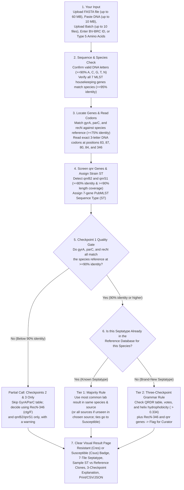
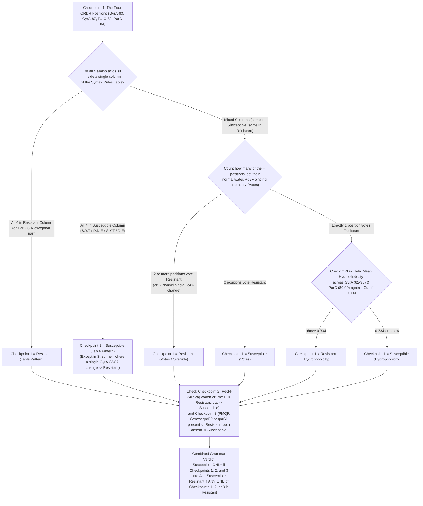
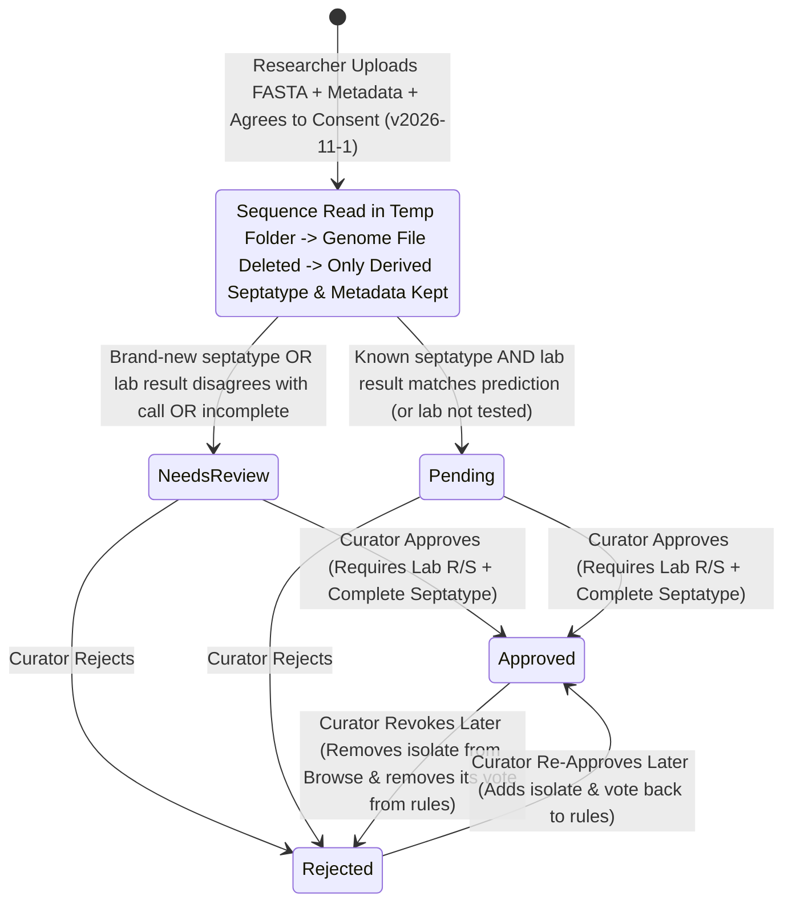

# CiproTyper: 
**Live Website:** [https://septatyper-is.onrender.com/](https://septatyper-is.onrender.com/)  
**Founding Research Paper:** Ghosh A, Deb P, Bose P, Sk I, Biswas S, Mukhopadhyay AK, Ganguly D, Chattopadhyay S. Generic context-dependence governs clonal emergence of ciprofloxacin resistance mutations. *Scientific Reports*. 2026. [https://doi.org/10.1038/s41598-026-75690-y](https://doi.org/10.1038/s41598-026-75690-y)  
**Software Architecture and Technical Reference (Separate Guide):** See [`TECHNICAL_ARCHITECTURE.md`](TECHNICAL_ARCHITECTURE.md) (or the [GitHub Repository](https://github.com/ikbalsk/Septatyper) and [Interactive API Guide](https://www.google.com/search?q=https://septatyper-is.onrender.com/docs)) for all software design, database structure, and programming details.

## 1. What is CiproTyper and Why Did We Build It?

**Ciprofloxacin** is one of the most common antibiotics doctors use to treat bacterial infections of the gut, urinary tract, lungs, and bloodstream. Over time, many bacteria have learned how to survive this medicine. When a bacterium can survive standard treatment with ciprofloxacin, we call it **Resistant**. When the medicine still kills or stops the bacterium as expected, we call it **Susceptible**.

Usually, when scientists read a bacterium's DNA sequence to check for drug resistance, existing tools simply list individual mutations or resistance genes one by one. However, in our study of 2,734 bacterial samples ([Ghosh et al., 2026](https://doi.org/10.1038/s41598-026-75690-y)), we found that **context matters**. A single mutation or resistance gene that makes one bacterial species resistant may have no effect at all in another species, or may only cause resistance when paired with a specific neighboring amino acid.

To make this discovery easy for any biologist, student, or researcher to use without needing programming skills, we built **CiproTyper** (the latest version of **SeptaTyper**, release `3.7.1`). It does three main jobs in one free website:

1. **Predicts Ciprofloxacin Resistance:** You upload a bacterial DNA sequence (or type in a genome ID or five amino acids), and the site tells you whether the sample is likely **Resistant (Cres)** or **Susceptible (Csus)**, along with a clear step-by-step biological explanation.
2. **Shows the Sample's Strain Type and Similar Isolates:** It identifies your bacterium's **Multilocus Sequence Type (ST)** (its genetic family or clone, such as `ST131` in *E. coli* or `ST258` in *K. pneumoniae*) and shows you how many similar isolates in our collection came from the same body site and country.
3. **Hosts a Growing Public Collection of 2,734 Genomes:** Anyone can browse, filter, map, and download our reference collection of 2,734 bacterial genomes, or submit new isolates with laboratory test results for curator review.

**Important Research Notice:** CiproTyper is built strictly for scientific research and public health tracking. It is not a medical device and must never be used to choose treatment for a patient. Always confirm predictions with standard laboratory antibiotic susceptibility testing (AST).

| Key Feature | Details in CiproTyper (SeptaTyper v3.7.1) |
| :--- | :--- |
| **Four Supported Bacterial Species** | *Escherichia coli*, *Shigella sonnei*, *Salmonella enterica* subsp. I, and *Klebsiella pneumoniae* |
| **Founding Reference Collection** | **2,734 bacterial genomes** (**1,669 Resistant**, **1,065 Susceptible**) from [Ghosh et al. (2026)](https://doi.org/10.1038/s41598-026-75690-y) |
| **Isolates per Species** | *K. pneumoniae*: 1,490 (1,319 R, 171 S); *S. enterica* subsp. I: 510 (6 R, 504 S); *E. coli*: 400 (193 R, 207 S); *S. sonnei*: 334 (151 R, 183 S) |
| **Founding Isolation Sources (3)** | Stool / fecal (`1,105` isolates), Urine (`1,231` isolates), and Respiratory (`398` isolates) |
| **Supported Submission Sources (12 + Unknown)** | Stool, Urine, Respiratory, Blood, Wound or skin, Cerebrospinal fluid (CSF), Abdominal, Genital tract, Environment, Food, Animal, Other source, plus Unknown / not specified |
| **Diversity in Founding Collection** | **64 unique septatypes**, **24 tetratypes**, **268 sequence types (STs)**, and **28 countries** (249 countries available for new submissions) |
| **Accuracy of Past-Record Lookup (Majority Rule)** | **98.1% overall** (2,681 of 2,734 founding isolates matched; 96.8% to 99.8% across species and source groups) |
| **Accuracy of Biological Rules Alone (Grammar Rule)** | **97.2% overall** (94.4% to 99.2% across species and source groups) |
| **Analysis Speed** | About **0.6 seconds** for a complete 5-million-base bacterial genome |

## 2. The Biology Behind the Septatype: Five Codons and Two Genes

### 2.1 How Ciprofloxacin Works and Why Context Matters

Inside a healthy bacterial cell, two essential enzymes manage the twisting and untangling of DNA during cell division:

* **DNA gyrase** (whose main drug-binding subunit is encoded by the **`gyrA`** gene)
* **Topoisomerase IV** (whose main drug-binding subunit is encoded by the **`parC`** gene)

Ciprofloxacin kills bacteria by locking onto these two enzymes while they are attached to DNA, blocking DNA replication. To hold onto the enzyme, ciprofloxacin relies on a tiny molecular bridge made of **water molecules and a positively charged magnesium ion (`Mg2+`)**. This bridge is held in place by two specific amino-acid positions inside the **Quinolone Resistance-Determining Region (QRDR)** of each enzyme:

1. **Position `GyrA-83` and Position `ParC-80` (Normally Serine, `S`):** Serine carries a water-friendly **hydroxyl group (`-OH`)** that forms a hydrogen bond with the water-`Mg2+` bridge. If a mutation replaces Serine with an oily (hydrophobic) amino acid like Leucine (`L`), Isoleucine (`I`), or Phenylalanine (`F`), that `-OH` anchor is lost.
2. **Position `GyrA-87` (Normally Aspartate, `D`) and Position `ParC-84` (Normally Glutamate, `E`):** Aspartate and Glutamate are **acidic, negatively charged** amino acids. Their negative charge attracts and holds the positively charged `Mg2+` ion. If they mutate to uncharged amino acids like Asparagine (`N`), Glycine (`G`), or Valine (`V`), the bridge is weakened.

However, the four QRDR positions (`GyrA-83`, `GyrA-87`, `ParC-80`, and `ParC-84`) work together rather than separately. For example, keeping a negatively charged Glutamate (`E`) at `ParC-84` normally helps the drug bind when `ParC-80` is a water-friendly Serine (`S`). Yet if `ParC-80` changes to an oily Isoleucine (`I`), the pocket around `ParC-84` becomes oily and non-polar, and the `I-E` pair acts as a resistant state.

Beyond `gyrA` and `parC`, two other biological players shape ciprofloxacin survival:

* **DNA Repair Protein `RecN` (Position `RecN-346`):** When ciprofloxacin damages bacterial DNA, the cell uses the `RecN` protein to repair double-strand breaks. At position `346` of `RecN`, sensitive bacteria usually carry the amino acid Leucine (`L`) written with the DNA triplet **`cta`**. Resistant bacteria can either change the amino acid to **Phenylalanine (`F`)** or keep Leucine (`L`) but switch the DNA triplet from **`cta` to `ctg`**. Even though both `cta` and `ctg` code for Leucine (a **synonymous codon change**), bacteria read the `ctg` triplet much more efficiently during translation, producing more `RecN` repair protein to survive drug damage.
* **Plasmid-Borne Protection Genes (`qnrB2` and `qnrS1`):** Bacteria can also carry mobile DNA rings (plasmids) bearing **Plasmid-Mediated Quinolone Resistance (PMQR)** genes from the `qnrB` and `qnrS` families. The Qnr proteins fold into a shape that mimics DNA and physically shields DNA gyrase and topoisomerase IV from ciprofloxacin.

### 2.2 What the Seven-Part Septatype String Means

CiproTyper combines these five chromosomal positions and two plasmid genes into a single seven-part code joined by dashes, called the **septatype**:

```text
[GyrA-83]-[GyrA-87]-[ParC-80]-[ParC-84]-[RecN-346]-[qnrB2]-[qnrS1]
```

The first four letters (`[GyrA-83]-[GyrA-87]-[ParC-80]-[ParC-84]`) are called the **tetratype**. All position numbers use standard *Escherichia coli* numbering.

| Part # | Gene & Position | Normal Susceptible State | Common Resistant Changes | Biological Meaning |
| :--- | :--- | :--- | :--- | :--- |
| **1** | **GyrA-83** | `S` (Serine) | `L`, `F`, `I`, `W` | Holds the water-`Mg2+` bridge in DNA gyrase via its `-OH` group. |
| **2** | **GyrA-87** | `D` (Aspartate) | `N`, `G`, `Y`, `A` (or `D`/`E` in resistant combos) | Stabilizes the `Mg2+` ion in DNA gyrase via its negative charge. |
| **3** | **ParC-80** | `S` (Serine) | `I`, `F`, `W` (or `S` in the `S-K` exception pair) | Holds the water-`Mg2+` bridge in topoisomerase IV via its `-OH` group. |
| **4** | **ParC-84** | `E` (Glutamate) | `V`, `G`, `K` (or `E`/`D` next to an oily `ParC-80`) | Stabilizes the `Mg2+` ion in topoisomerase IV; depends on `ParC-80`. |
| **5** | **RecN-346** | `L` (Leucine, codon `cta`) | `L` (codon `ctg`) or `F` (Phenylalanine) | DNA double-strand break repair protein; `ctg` or `F` boosts repair. |
| **6** | **qnrB2** | `0` (Absent) | `1` (Present) | Plasmid gene (`qnrB` family) that shields gyrase and topoisomerase IV. |
| **7** | **qnrS1** | `0` (Absent) | `1` (Present) | Plasmid gene (`qnrS` family) that shields gyrase and topoisomerase IV. |

Here are three everyday examples of how to read a septatype:

* **`S-D-S-E-L-0-0`** is the normal, wild-type **Susceptible** septatype (`S` at GyrA-83, `D` at GyrA-87, `S` at ParC-80, `E` at ParC-84, `L` at RecN-346, and `0` for both `qnrB2` and `qnrS1`).
* **`L-N-I-E-L-0-0`** is the most common **Resistant** septatype in *E. coli* (Serine changed to Leucine at GyrA-83, Aspartate changed to Asparagine at GyrA-87, Serine changed to Isoleucine at ParC-80, Glutamate kept at ParC-84, Leucine at RecN-346, and no `qnr` genes).
* **`I-N-I-E-L-0-0`** and **`I-D-I-E-L-0-0`** are the two most common **Resistant** septatypes in *K. pneumoniae*.

Because the 5th letter of the septatype shows the amino acid (`L` or `F`) rather than the 3-letter DNA codon, CiproTyper always reads and displays the exact DNA triplet (`cta` or `ctg`) right below the `RecN-346` tile whenever you upload a DNA sequence.

## 3. How CiproTyper Reads Your Sequence and Checks Quality

### Figure 1. Step-by-Step Workflow from DNA Sequence to Resistance Call



* **Figure 1 Legend:** How CiproTyper processes an uploaded bacterial sequence, checks species and gene quality thresholds, and decides between Tier 1 (Majority Rule) and Tier 2 (Grammar Rule).

### 3.1 Five Ways to Enter Your Sample

On the **Predict** page, you can test your bacterium in five ways:

1. **Upload a FASTA File:** Drop in an assembled whole-genome sequence or individual gene sequences (`.fa`, `.fasta`, `.fna`, `.fas`, `.txt`, or compressed `.gz` files up to **60 MB**). Your sequence is analysed in a temporary folder and immediately deleted as soon as your result appears.
2. **Paste a DNA Sequence:** Paste up to **10 MB** of DNA bases (enough for an entire bacterial genome) directly into the text box.
3. **Run a Batch of Files:** Select up to **10 genome FASTA files** at once to get a combined comparison table that you can download as a spreadsheet (CSV) or print as a PDF report.
4. **Type a BV-BRC Genome ID:** Enter between **1 and 10 genome IDs** from the [Bacterial and Viral Bioinformatics Resource Center (BV-BRC)](https://www.bv-brc.org/) (for example, `562.7710`). CiproTyper automatically fetches the genome from BV-BRC, reads the bacterial species from its record, runs the prediction, tells you if that genome is already part of our 2,734 reference isolates, and deletes the downloaded sequence.
5. **Enter the Five Amino Acids by Hand:** If you already know the amino acids at `GyrA-83`, `GyrA-87`, `ParC-80`, `ParC-84`, and `RecN-346` (plus whether `qnrB` or `qnrS` is present and the optional `RecN-346` codon), you can type them directly to get an instant prediction.

### 3.2 Species-Specific Reference Genes and MLST Schemes

To make sure every codon is read accurately, CiproTyper aligns your DNA against official GenBank reference genes tailored to each of the four supported bacterial species, and identifies the strain's **Sequence Type (ST)** using the 7-gene [PubMLST](https://pubmlst.org/) schemes ([Jolley et al., 2018](https://doi.org/10.12688/wellcomeopenres.14826.1)):

| Bacterial Species | Reference `gyrA` Accession | Reference `parC` Accession | Reference `recN` Accession | 7-Gene MLST Scheme Used |
| :--- | :--- | :--- | :--- | :--- |
| ***Escherichia coli*** | `CP058222.1` | `CP058222.1` | `CP058222.1` | **Achtman** (`adk`, `fumC`, `gyrB`, `icd`, `mdh`, `purA`, `recA`) |
| ***Shigella sonnei*** | `AAVEOC010000165.1` | `AAVEOC010000011.1` | `AAVEOC010000127.1` | **Achtman** (`adk`, `fumC`, `gyrB`, `icd`, `mdh`, `purA`, `recA`) |
| ***Salmonella enterica* subsp. I** | `CP163542.1` | `CP163542.1` | `CP163542.1` | **Achtman** (`aroC`, `dnaN`, `hemD`, `hisD`, `purE`, `sucA`, `thrA`) |
| ***Klebsiella pneumoniae*** | `CP089383.1` | `CP089383.1` | `CP089383.1` | **Diancourt** (`gapA`, `infB`, `mdh`, `pgi`, `phoE`, `rpoB`, `tonB`) |
| **All 4 Species (`qnr` Plasmids)** | `qnrB2`: `CP032523.1` (645 bp) | `qnrS1`: `CP032523.1` (657 bp) | Wild-type positions: `S, D, S, E, L` | Exact match across all 7 MLST genes required to name an ST |

### 3.3 Every Quality Check and Threshold Limit Explained Simply

CiproTyper applies strict quality checks at every step so that poor-quality sequences, partial uploads, or accidentally choosing the wrong bacterial species never produce a misleading result:

| What is Checked | Exact Threshold or Limit | What Happens If a Sample Does Not Meet It |
| :--- | :--- | :--- |
| **1. Valid DNA Sequence Check** | At least **90%** of letters must be `A`, `C`, `G`, `T`, or `N` | If fewer than 90% of letters are DNA bases, the upload is rejected with a friendly message explaining that protein sequences are not accepted. |
| **2. File and Paste Size Limits** | Upload up to **60 MB** (or **240 MB** unzipped); Paste up to **10 MB**; Batch up to **10 files** | Stops oversized files with a clear message asking you to upload a single assembly file. |
| **3. Finding `gyrA`, `parC`, and `recN`** | Minimum **75% DNA identity** (and BLAST e-value `<= 1e-20`) | Below 75% identity, the gene is marked as **not found**. |
| **4. Gene Match & Length Warnings** | Warning below **92% DNA identity** or below **90% gene length coverage** | Displays a warning note advising you to check whether the gene is broken across contigs or if a different species was selected. |
| **5. Checkpoint 1 Quality Gate (`CP1_MIN_ID`)** | All three genes (`gyrA`, `parC`, `recN`) must match the species reference at **90% identity or higher** | **Critical Safety Gate:** If any of the three chromosomal genes is missing or matches below **90% identity**, the amino-acid positions cannot be trusted. **Checkpoint 1 is turned off**, no septatype string is reported, and the call is made from **Checkpoints 2 and 3 only** with a clear warning. |
| **6. Species Verification Gate (`MLST_SPECIES_MIN_ID`)** | For whole genomes (`>= 1 million bases`), all **7 MLST genes** must match the chosen species scheme at **95% identity or higher** | Displays a prominent red banner: *"Please verify the species selected and resubmit."* |
| **7. Clean Codon Reading** | Exact 3-base alignment with **no gaps, no stop codons (`*`), and no ambiguous bases (`N`)** | If any of the 5 codons has a gap, stop codon, or unknown base, that position is not guessed and no complete septatype is built. |
| **8. Plasmid `qnrB2` and `qnrS1` Detection** | At least **80% DNA identity** AND at least **90% gene length coverage** | Only hits meeting both limits count as **Present (`1`)**. For gene-only uploads (`< 1 million bases`), the site warns that `"absent"` only means no `qnr` sequence was in the partial file, and lets you set `qnrB`/`qnrS` manually. |
| **9. Strain Sequence Type (ST) Naming** | **100% identity (`>= 99.999%`)** across the full length of all **7 MLST alleles** | An ST number (like `ST131`) is reported only when all 7 alleles match known alleles exactly. Nearest matches (`>= 90%` identity and `>= 90%` coverage) are marked with `~`. |
| **10. Reference Support Warnings** | **Fewer than 5 reference isolates** (`LOW_SUPPORT = 5`) or **majority below 80%** (`MIXED = 0.80`) | Warns you when a known septatype rests on fewer than 5 database records or when the database isolates are a mix of Resistant and Susceptible. |
| **11. Database Tie-Breaker Rule** | Equal number of Resistant and Susceptible reference isolates (`R == S`) | If reference isolates are split 50/50, the call defaults to **Susceptible** and flags the even split. |
| **12. Hydrophobicity (`<H>`) Cutoff** | **Cutoff = `0.334`** (midpoint between wild-type `S-D-S-E = 0.270` and resistant `L-N-I-E = 0.397`) | Used in the Grammar Rule when the 4 QRDR positions are mixed and exactly 1 position votes Resistant: **`<H> > 0.334` = Resistant**, **`<H> <= 0.334` = Susceptible**. |

## 4. How the Resistance Call is Made: Majority Rule vs. Grammar Rule

Once CiproTyper has read the five positions and two `qnr` genes, it predicts the phenotype using a two-tier system.

### 4.1 Tier 1: The Majority Rule (Checking Past Real-World Isolates)

Whenever your sample passes the 90% gene-identity gate and its seven-part septatype has **already been seen** in our reference database for that bacterial species, CiproTyper uses the **Majority Rule**:

1. **Same Species and Same Isolation Source (`tier = "database"`):** If you selected a specific body site (for example, *E. coli* from **Urine**) and our database has *E. coli* urine isolates with that exact septatype, CiproTyper counts how many of those isolates tested **Resistant** vs. **Susceptible** in the laboratory. **Whichever group is larger wins.** (If both groups have the exact same count, it calls **Susceptible**.)
2. **Same Species across All Sources (`tier = "database_other_site"`):** If that septatype has not yet been seen in the specific body site you chose (for example, **Blood**), but it *has* been seen in other body sites for the **same species**, CiproTyper pools all isolates of that species with that septatype, reports the majority phenotype, and adds a note explaining that isolates from other sources were used.
3. **Full Transparency on Reference Isolates:** Right below the prediction badge, the result page tells you the exact number of matching reference isolates, which body sites and countries they came from, and which **Sequence Types (STs)** they belong to, highlighting `"your genome"` if your sample shares the same ST as a known clone in the database.

### 4.2 Tier 2: The Three-Checkpoint Grammar Rule (For Brand-New Septatypes)

If your bacterium carries a **brand-new septatype** that has never been recorded in the reference collection for that species, CiproTyper uses its **Three-Checkpoint Biological Grammar** (`tier = "grammar"`) and flags the sample as a new septatype for curator review. Importantly, CiproTyper also shows these three checkpoints on the screen for every Tier 1 call so you can always see the biological reasoning behind the phenotype.

### Figure 2. How the Three-Checkpoint Grammar and Hydrophobicity (`<H>`) Cutoff Work



```text
QRDR Helix Mean Hydrophobicity <H> Number Line (Eisenberg Scale):

  0.215          0.270 (Wild-Type)       0.334 (Midpoint Cutoff)     0.397 (Resistant Ref)       0.480
    |----------------|-------------------------|---------------------------|-----------------------|
   Min          S-D-S-E (0.270)           Cutoff = 0.334              L-N-I-E (0.397)             Max
                Mean Sus (0.274)     [<=0.334: Sus | >0.334: Res]     Mean Res (0.391)
                L-D-S-E (0.322)                                       I-N-I-E / F-N-I-E
                F-D-S-E (0.327)
```

* **Figure 2 Legend:** Decision steps of the Three-Checkpoint Grammar and the QRDR helix mean hydrophobicity (`<H>`) scale showing how the `0.334` cutoff sits halfway between the wild-type susceptible reference (`S-D-S-E`, `0.270`) and the common resistant reference (`L-N-I-E`, `0.397`).

#### Checkpoint 1: The Four QRDR Positions (`GyrA-83`, `GyrA-87`, `ParC-80`, `ParC-84`)

First, CiproTyper compares your sample's four QRDR amino acids against the published syntax table ([Ghosh et al., 2026](https://doi.org/10.1038/s41598-026-75690-y)):

| QRDR Position | Susceptible Column (`Csus`) Amino Acids & Chemical Role | Resistant Column (`Cres`) Amino Acids & Chemical Role | Why Context Matters Here |
| :--- | :--- | :--- | :--- |
| **GyrA-83** | **`S, Y, T`** (Polar amino acid with an `-OH` hydroxyl group) | **`F, L, I, W`** (Oily / hydrophobic amino acid) | Losing the `-OH` group breaks the hydrogen bond to the water-`Mg2+` bridge. |
| **GyrA-87** | **`D, N, E`** (Negatively charged or polar amino acid) | **`N, D, G, Y, A, E`** (Uncharged or negatively charged amino acid) | **`D`, `N`, and `E` appear in both columns**, so their effect depends on the other three positions. |
| **ParC-80** | **`S, Y, T`** (Polar amino acid with an `-OH` hydroxyl group) | **`I, F, W`** (Oily / hydrophobic amino acid) + **Exception: `S`** | `S` is Susceptible unless it is paired with `K` at `ParC-84` (the `S-K` exception pair). |
| **ParC-84** | **`D, E`** (Negatively charged amino acid) | **`E, V, D`** (Oily or negatively charged amino acid) + **Exception: `K`** | **`D` and `E` appear in both columns**; the **exception pair `S-K`** (`ParC-80 = S` together with `ParC-84 = K`, as in `F-N-S-K`) is Resistant. |

Checkpoint 1 decides in the following order:

1. **All Four in the Resistant Column:** If all four amino acids belong to the Resistant column (including the `ParC` `S-K` exception pair when both `S` at `ParC-80` and `K` at `ParC-84` are present together), Checkpoint 1 says **Resistant**.
2. ***Shigella sonnei* Single-GyrA Rule:** In *S. sonnei*, our reference isolates show that even a single change at `GyrA-83` or `GyrA-87` (such as `L-D-S-E` or `S-Y-S-E`) causes resistance. So in *S. sonnei*, a single `GyrA` vote immediately calls **Resistant**.
3. **All Four in the Susceptible Column:** If all four amino acids sit in the Susceptible column (`S,Y,T` / `D,N,E` / `S,Y,T` / `D,E`), Checkpoint 1 says **Susceptible**.
4. **What Happens When the Four Amino Acids Are Mixed Across Both Columns:** If some amino acids sit only in the Resistant column and others sit only in the Susceptible column (for example, `L-D-S-E` in *E. coli* or `F-D-S-E` in *S. enterica*), the table alone does not give an answer. CiproTyper then counts how many of the four positions have lost their normal water/magnesium-binding chemistry (**Resistant Votes**):
   * **`GyrA-83` votes Resistant** if it is not `S`, `T`, or `Y` (hydroxyl group lost).
   * **`GyrA-87` votes Resistant** if it is not `D` or `E` (negative charge lost).
   * **`ParC-80` votes Resistant** if it is not `S`, `T`, or `Y` (hydroxyl group lost).
   * **`ParC-84` votes Resistant** if it is not `D` or `E` (negative charge lost), **OR** if it *is* `D` or `E` but sits next to an oily/hydrophobic `ParC-80` (`A, V, I, L, M, F, W, P, G, C`).
   * **2 or more Resistant votes** -> Checkpoint 1 says **Resistant**.
   * **0 Resistant votes** -> Checkpoint 1 says **Susceptible**.
   * **Exactly 1 Resistant vote** -> Settled by the **QRDR Helix Mean Hydrophobicity (`<H>`)** against the **`0.334` cutoff**.

#### How the QRDR Helix Mean Hydrophobicity (`<H>`) and `0.334` Cutoff Are Calculated

Every amino acid has a standard oiliness/water-repelling score (*H*) on the **Eisenberg consensus hydrophobicity scale** ([Eisenberg et al., 1984](https://doi.org/10.1016/0022-2836(84)90309-7)), where positive numbers mean oily (hydrophobic) and negative numbers mean water-loving (hydrophilic):

| Amino Acid | Letter | Eisenberg *H* | Chemical Group in CiproTyper | Amino Acid | Letter | Eisenberg *H* | Chemical Group in CiproTyper |
| :--- | :---: | :---: | :--- | :--- | :---: | :---: | :--- |
| **Isoleucine** | `I` | `+1.38` | `hydrophobic` | **Proline** | `P` | `+0.12` | `hydrophobic` |
| **Phenylalanine** | `F` | `+1.19` | `hydrophobic` | **Threonine** | `T` | `-0.05` | `polar, hydroxyl group` |
| **Valine** | `V` | `+1.08` | `hydrophobic` | **Serine** | `S` | `-0.18` | `polar, hydroxyl group` |
| **Leucine** | `L` | `+1.06` | `hydrophobic` | **Histidine** | `H` | `-0.40` | `basic (positive)` |
| **Tryptophan** | `W` | `+0.81` | `hydrophobic` | **Glutamate** | `E` | `-0.74` | `acidic (negative)` |
| **Methionine** | `M` | `+0.64` | `hydrophobic` | **Asparagine** | `N` | `-0.78` | `polar, uncharged` |
| **Alanine** | `A` | `+0.62` | `hydrophobic` | **Glutamine** | `Q` | `-0.85` | `polar, uncharged` |
| **Glycine** | `G` | `+0.48` | `hydrophobic` | **Aspartate** | `D` | `-0.90` | `acidic (negative)` |
| **Cysteine** | `C` | `+0.29` | `hydrophobic` | **Lysine** | `K` | `-1.50` | `basic (positive)` |
| **Tyrosine** | `Y` | `+0.26` | `polar, hydroxyl group` | **Arginine** | `R` | `-2.53` | `basic (positive)` |

Instead of averaging only the 4 mutated positions, CiproTyper measures `<H>` across the **entire drug-binding alpha-helix** of both enzymes:

1. **GyrA Helix (Residues 82 to 93, 12 amino acids):** `D [GyrA-83] A V Y [GyrA-87] T I V R M A`. The 10 surrounding amino acids stay fixed (their *H* scores add up to `+2.20`), and your sample's residues are plugged in at positions 83 and 87:
   $$\text{GyrA Helix Mean} = \frac{2.20 + H(\text{GyrA-83}) + H(\text{GyrA-87})}{12}$$
2. **ParC Helix (Residues 80 to 90, 11 amino acids):** `[ParC-80] A C Y [ParC-84] A M V L M A`. The 9 surrounding amino acids stay fixed (their *H* scores add up to `+5.83`), and your sample's residues are plugged in at positions 80 and 84:
   $$\text{ParC Helix Mean} = \frac{5.83 + H(\text{ParC-80}) + H(\text{ParC-84})}{11}$$
3. **Combined QRDR Helix Mean (`<H>`):** Average of the two helix means, rounded to 3 decimal places:
   $$\langle H \rangle = \frac{\text{GyrA Helix Mean} + \text{ParC Helix Mean}}{2}$$
4. **Why the Cutoff is `0.334`:**
   * A normal **wild-type susceptible bacterium (`S-D-S-E`)** has a GyrA helix mean of `0.093` and a ParC helix mean of `0.446`, giving **`<H> = 0.270`**.
   * A typical **resistant bacterium (`L-N-I-E`)** has a GyrA helix mean of `0.207` and a ParC helix mean of `0.588`, giving **`<H> = 0.397`**.
   * Halfway between `0.270` and `0.397` is **`0.334`**. If a single-vote sample has **`<H>` above `0.334`**, Checkpoint 1 calls it **Resistant**; if **`0.334` or below**, Checkpoint 1 calls it **Susceptible**.

#### Checkpoint 2: `RecN-346` Amino Acid and Codon Rule

* **Susceptible:** If `RecN-346` is Leucine (`L`) written with the DNA codon **`cta`** (or if the codon is another leucine triplet or unknown).
* **Resistant:** If `RecN-346` is Leucine (`L`) written with the high-expression DNA codon **`ctg`**, OR if the amino acid changed to **Phenylalanine (`F`)**.

#### Checkpoint 3: Plasmid `qnrB2` and `qnrS1` Genes

* **Susceptible:** If both `qnrB2` and `qnrS1` are absent (`0` and `0`).
* **Resistant:** If either `qnrB2` or `qnrS1` (or both) is present (`1`).

#### Putting the Three Checkpoints Together

* The Grammar Rule calls a bacterium **Susceptible** **only when all three checkpoints** (Checkpoint 1, Checkpoint 2, and Checkpoint 3) say Susceptible.
* If **any one** of the three checkpoints says Resistant, the Grammar Rule calls the bacterium **Resistant**, and the result page highlights and pulses the exact checkpoint box that decided the call.

## 5. What Our 2,734 Reference Genomes Show

### 5.1 Accuracy Across Species and Body Sites

Our founding reference database comes from Supplementary Table S1 of [Ghosh et al. (2026)](https://doi.org/10.1038/s41598-026-75690-y) and contains **2,734 bacterial genomes** across four species and three body sites. When tested across these 2,734 genomes, the Tier 1 Majority Rule matches the laboratory phenotype for **2,681 isolates (98.1% overall)**, and the Tier 2 Grammar Rule alone matches **97.2% overall**.

| Bacterial Species | Body Site / Source | Total Isolates | Resistant Isolates | Susceptible Isolates | Unique Septatypes | Tier 1 Majority Rule Accuracy | Tier 2 Grammar Rule Accuracy |
| :--- | :--- | :---: | :---: | :---: | :---: | :---: | :---: |
| ***Escherichia coli*** | Stool (`FECAL`) | 184 | 19 (10.3%) | 165 (89.7%) | 6 | **98.9%** | 97.3% |
| ***Escherichia coli*** | Urine (`URINE`) | 216 | 174 (80.6%) | 42 (19.4%) | 17 | **98.1%** | 94.4% |
| ***Klebsiella pneumoniae*** | Stool (`FECAL`) | 77 | 31 (40.3%) | 46 (59.7%) | 11 | **98.7%** | 97.4% |
| ***Klebsiella pneumoniae*** | Respiratory (`RESPIRATORY`) | 398 | 350 (87.9%) | 48 (12.1%) | 26 | **97.2%** | 96.5% |
| ***Klebsiella pneumoniae*** | Urine (`URINE`) | 1,015 | 938 (92.4%) | 77 (7.6%) | 36 | **96.8%** | 96.7% |
| ***Salmonella enterica* subsp. I** | Stool (`FECAL`) | 510 | 6 (1.2%) | 504 (98.8%) | 10 | **99.8%** | 99.2% |
| ***Shigella sonnei*** | Stool (`FECAL`) | 334 | 151 (45.2%) | 183 (54.8%) | 13 | **99.4%** | 98.5% |
| **All Founding Isolates** | **All 7 Groups Combined** | **2,734** | **1,669 (61.0%)** | **1,065 (39.0%)** | **64 unique** | **98.1% (2,681/2,734)** | **97.2%** |

### Figure 3. Visual Summary of Reference Accuracy and Resistance Balance (`n = 2,734`)

```text
A. Accuracy by Species and Body Site (Tier 1 Majority Rule vs. Tier 2 Grammar Rule)
------------------------------------------------------------------------------------
E. coli (Fecal, n=184)         | Tier 1: #################### 98.9% | Tier 2: ################### 97.3%
E. coli (Urine, n=216)         | Tier 1: #################### 98.1% | Tier 2: ################### 94.4%
K. pneumoniae (Fecal, n=77)    | Tier 1: #################### 98.7% | Tier 2: ################### 97.4%
K. pneumoniae (Resp., n=398)   | Tier 1: ###################  97.2% | Tier 2: ################### 96.5%
K. pneumoniae (Urine, n=1,015) | Tier 1: ###################  96.8% | Tier 2: ################### 96.7%
S. enterica (Fecal, n=510)     | Tier 1: #################### 99.8% | Tier 2: #################### 99.2%
S. sonnei (Fecal, n=334)       | Tier 1: #################### 99.4% | Tier 2: #################### 98.5%
------------------------------------------------------------------------------------
Pooled Founding Set (n=2,734)  | Tier 1: 98.1% (2,681/2,734)        | Tier 2: 97.2%

B. Proportion of Resistant [R] vs. Susceptible [S] Isolates per Species
------------------------------------------------------------------------------------
K. pneumoniae (n=1,490) : [RRRRRRRRRRRRRRRRRR.. ] 1,319 R (88.5%) | 171 S (11.5%)
E. coli       (n=400)   : [RRRRRRRRRR.......... ]   193 R (48.2%) | 207 S (51.8%)
S. sonnei     (n=334)   : [RRRRRRRRR........... ]   151 R (45.2%) | 183 S (54.8%)
S. enterica   (n=510)   : [.................... ]     6 R ( 1.2%) | 504 S (98.8%)
```

### 5.2 Why the Same `qnr` Gene Means Different Things in Different Species

A great example of why CiproTyper keeps its rules separated by bacterial species can be seen when we look at isolates that have a completely normal, wild-type `GyrA` and `ParC` (`S-D-S-E`) but carry a plasmid `qnrB2` or `qnrS1` gene:

| Bacterial Species | `qnrB2` | `qnrS1` | Total Isolates | Resistant in Lab | % Resistant | What This Shows Biologically |
| :--- | :---: | :---: | :---: | :---: | :---: | :--- |
| ***Escherichia coli*** | Absent | Absent | 165 | 3 | 1.8% | Normal `S-D-S-E` without `qnr` is susceptible. |
| ***Escherichia coli*** | Absent | **Present** | 9 | **0** | **0.0%** | In *E. coli*, `qnrS1` alone on a normal `S-D-S-E` background stayed susceptible. |
| ***Escherichia coli*** | **Present** | Absent | 1 | **0** | **0.0%** | Single `qnrB2` isolate on `S-D-S-E` in *E. coli* was susceptible. |
| ***Klebsiella pneumoniae*** | Absent | Absent | 138 | 6 | 4.3% | Normal `S-D-S-E` without `qnr` is susceptible. |
| ***Klebsiella pneumoniae*** | Absent | **Present** | 38 | **24** | **63.2%** | Most *K. pneumoniae* with `qnrS1` on `S-D-S-E` are resistant. |
| ***Klebsiella pneumoniae*** | **Present** | Absent | 124 | **103** | **83.1%** | Over 4 out of 5 *K. pneumoniae* with `qnrB2` on `S-D-S-E` are resistant. |
| ***Klebsiella pneumoniae*** | **Present** | **Present** | 2 | **2** | **100.0%** | Both isolates carrying `qnrB2` + `qnrS1` are resistant. |
| ***Salmonella enterica* subsp. I** | Absent | Absent | 442 | 0 | 0.0% | Normal `S-D-S-E` is 100% susceptible. |
| ***Salmonella enterica* subsp. I** | Absent / Present | Present / Absent | 3 | **0** | **0.0%** | All 3 `qnr`-positive `S-D-S-E` *S. enterica* isolates tested susceptible. |
| ***Shigella sonnei*** | Absent | Absent | 183 | 1 | 0.5% | Normal `S-D-S-E` without `qnr` is susceptible. |
| ***Shigella sonnei*** | Absent | **Present** | 7 | **7** | **100.0%** | Every `qnrS1`-positive `S-D-S-E` *S. sonnei* isolate is resistant. |
| ***Shigella sonnei*** | **Present** | Absent | 17 | **17** | **100.0%** | Every `qnrB2`-positive `S-D-S-E` *S. sonnei* isolate is resistant. |

Because the Tier 1 Majority Rule looks up each species separately, CiproTyper automatically calls `S-D-S-E-L-0-1` **Susceptible** in *E. coli* and *S. enterica*, and **Resistant** in *K. pneumoniae* and *S. sonnei*.

## 6. User Guide: How to Use Every Page on the Website

When you open [https://septatyper-is.onrender.com/](https://septatyper-is.onrender.com/), you will see a clean blue-and-white navigation bar at the top with seven main sections (plus the calculation and curator pages):

1. **Home (`#/`):** Gives a quick overview of the 2,734 genomes, an interactive 7-tile animation showing how a susceptible *E. coli* (`S-D-S-E-L-0-0`) differs from a resistant one (`L-N-I-E-L-0-0`), and the summary accuracy table for all four species.
2. **Predict (`#/predict`):**
   * **Step 1:** Choose your bacterium's **Species** and **Isolation source** (if you do not know the body site, leave it on `Unknown / not specified`).
   * **Step 2:** Pick your input tab (**Upload file**, **Paste sequence**, **Batch**, **BV-BRC ID**, or **Enter residues**). If you are uploading a single gene file rather than a whole genome, click *"Gene sequences only? Set the qnr status yourself"* to tell the tool whether `qnrB` or `qnrS` is present.
   * **Step 3:** Click **Predict phenotype**. You will get the **Resistant (Cres)** or **Susceptible (Csus)** call, the 7-tile septatype with any changed positions highlighted and the `RecN-346` codon shown underneath, your sample's **Sequence Type (ST)**, a table of matching reference isolates broken down by ST, country, and body site, and the full **Why Resistant / Why Susceptible** three-checkpoint explanation. You can save your report using **Print or save as PDF**, **Download CSV**, or **Download JSON**.
3. **Browse (`#/browse`):** Lets you search and filter all 2,734 founding genomes (plus approved community genomes) by **Species**, **Isolation source**, **Sequence type (ST)**, **Country**, **Septatype**, **Lab phenotype**, **Collection year range**, **Genome ID or name**, and **Source** (`Founding set` vs. `Community`). Every BV-BRC genome ID is a clickable link to its official [BV-BRC genome page](https://www.bv-brc.org/), and you can compare the **Laboratory phenotype**, the **BV-BRC computational prediction**, and the **CiproTyper prediction** side by side (a star `★` marks isolates where CiproTyper matches the laboratory result and BV-BRC does not). You can download any filtered view as CSV or JSON.
4. **Analytics (`#/analytics`):**
   * **Top 12 Septatypes by Source:** Shows a color-coded bar chart of the 12 most common septatypes in each species broken down by body site.
   * **Where is it Found? (World Map and Table):** Shows an interactive world map and country table that you can filter by species, ST (such as `ST131` or `ST258`), septatype, and phenotype to see global spread.
5. **Submit (`#/submit`) and Curate (`#/curate`):**
   * **How to Submit an Isolate:** Any researcher can contribute a new bacterial genome by choosing the species and body site, entering their **Submitter name** and **Contact email** (required), optionally adding a **BV-BRC genome ID** (with a `"Look up"` button that fills in the official name), **Country** (searchable list of 249 countries), **Year**, **Laboratory phenotype** (`Resistant` or `Susceptible`), **Affiliation**, and **Publication (DOI or web link)**, and uploading the genome FASTA file.
   * **7-Point Informed Consent (`Notice version 2026-11-1`):** Before sending, a short consent window explains that **your sequence file is deleted immediately after analysis**, your email stays private for curator questions only, and if a curator approves your isolate, its derived septatype, ST, metadata, and your submitter attribution become part of the public repository and rules.
   * **How Curation Works:** Submissions with a brand-new septatype or where the lab result disagrees with CiproTyper's prediction are placed in the **Needs review** list; others go to **Pending**. A curator signs in with a secret token on the **Curate** page to **Approve** or **Reject** each submission. Approving an isolate adds it to Browse and Analytics and adds its vote to the Tier 1 Majority Rule. If a mistake is discovered later, a curator can **Reject and remove** an approved isolate at any time, which cleanly removes both the isolate and its vote.
6. **Theory (`#/theory`) and Calculation (`#/calc`):**
   * **Theory:** Lets you click any common tetratype (or type any 4 amino acids) to watch an interactive diagram of the **ciprofloxacin + water + `Mg2+` binding pocket** update in real time, showing which hydrogen bonds and negative charges are intact, weakened, or lost. It also displays the three checkpoints, the validation tables, and the `qnr` edge-case table.
   * **Calculation (`#/calc`):** Shows the complete step-by-step arithmetic for the 12-residue `GyrA` helix (`82-93`) and 11-residue `ParC` helix (`80-90`) on the Eisenberg scale, lets you type any 4 sample and reference residues to see the worked math live, and shows the accuracy across 18 different hydrophobicity cutoffs (`0.20` to `0.50`).
7. **API and Data (`#/data`) and About (`#/about`):** Provide one-click full database downloads (CSV and JSON), copy-pasteable command-line and Python examples, one-click citation copying, and method and privacy notes.

### Figure 4. Community Submission and Reversible Curation Workflow



* **Figure 4 Legend:** How community submissions are processed without storing raw genome sequences, reviewed by curators, and added to (or reversibly removed from) the live reference repository.

## 7. Honest Limitations and What Users Should Keep in Mind

In line with bioinformatics journal standards, we state all limitations of CiproTyper (`v3.7.1`) openly so researchers can interpret results responsibly:

1. **Accuracy is Measured on the Founding Reference Set (Not Yet an Independent Test Set):** Both the **98.1%** Tier 1 Majority Rule accuracy and the **97.2%** Tier 2 Grammar Rule accuracy are **resubstitution accuracies**, meaning they were measured on the same 2,734 founding isolates from [Ghosh et al. (2026)](https://doi.org/10.1038/s41598-026-75690-y) that were used to build the reference table and write the grammar rules. Testing CiproTyper on a completely independent external collection of clinical genomes with laboratory susceptibility results is the next priority.
2. **Covers Four Bacterial Species and One Drug Only:** The rules are built specifically for **ciprofloxacin** in *E. coli*, *S. sonnei*, *S. enterica* subsp. I, and *K. pneumoniae*. They must not be used for other bacteria or other fluoroquinolone drugs without separate validation. Also, because *E. coli* and *S. sonnei* are genetically very close and share the same housekeeping genes, the tool cannot tell them apart automatically from sequence alone; you must select the species yourself.
3. **Requires Assembled DNA Sequences (Not Raw Sequencing Reads):** You must upload assembled contigs or gene sequences in FASTA format. Raw sequencing read files (`FASTQ` from Illumina, Nanopore, or PacBio) are not accepted and must be assembled first. If an assembly is broken right across one of the five target codons or has unknown bases (`N`) there, CiproTyper will not guess the codon and will not produce a septatype.
4. **Uneven Numbers Across Countries, Sources, and Species in the Founding Set:** More than half of the 2,734 founding genomes come from the United States (`1,495`), followed by Australia (`411`) and the United Kingdom (`409`). Also, while *K. pneumoniae* is mostly resistant (`88.5%`), *S. enterica* subsp. I has only **6 resistant isolates out of 510 (`1.2%`)**. Finally, the founding set covers Stool, Urine, and Respiratory isolates; the other 9 body sites and sources (`Blood`, `CSF`, `Wound`, `Food`, etc.) currently use pooled species-wide predictions until community submissions build up site-specific records for them.
5. **No Stored `RecN-346` DNA Codons in the Founding Spreadsheet:** When you upload a DNA sequence, CiproTyper reads the exact 3-letter codon at `RecN-346` to tell susceptible `cta` apart from resistant `ctg` (Checkpoint 2). However, the original `Table_S1.xlsx` spreadsheet only listed the amino-acid letter (`L` or `F`), not the DNA codon, so Checkpoint 2 for `ctg` could not be scored on those 2,734 stored table rows.
6. **Plasmid `qnr` Detection Uses Two Reference Alleles and Cannot Measure Gene Expression:** CiproTyper searches for `qnrB2` and `qnrS1` at `>= 80%` identity and `>= 90%` length coverage. Other `qnr` families (`qnrA`, `qnrC`, `qnrD`, `qnrE`, `qnrVC`), divergent alleles below 80% identity, or other resistance mechanisms such as `aac(6')-Ib-cr` or efflux pump changes (`acrAB-tolC`, `marA`, `soxS`, `ramA`) are not read. Conversely, finding a `qnr` gene in DNA does not prove the bacterium is actively expressing it (which is why a few `qnr`-positive isolates with wild-type `S-D-S-E` tested susceptible in the laboratory).
7. **Hydrophobicity (`<H>`) is Only a Last Tie-Breaker for Borderline Novel Septatypes:** Across all 2,734 founding isolates, resistant isolates have a higher average `<H>` (`0.391`) than susceptible ones (`0.274`), and the full three-checkpoint grammar reaches **97.2% accuracy** at the `0.334` cutoff. However, in the small borderline group of **148 isolates** where the four QRDR amino acids fall in mixed columns and carry exactly 1 Resistant vote, `<H>` alone is right for only **41.2%** at `0.334` (and at most **59.5%** at `0.24`). That is why `<H>` is used strictly as a final tie-breaker inside Tier 2 when a septatype has never been seen before.

## 8. Software Architecture, Database, and API Documentation

The complete technical details of how the server is built, how the SQLite database tables work, how to deploy the Docker container, or how to call the 25 REST API endpoints from code, please open the separate technical reference document:

* **Separate Technical & Software Reference:** [`TECHNICAL_ARCHITECTURE.md`](TECHNICAL_ARCHITECTURE.md)
* **Live Interactive API Documentation (Swagger UI):** [https://septatyper-is.onrender.com/docs](https://www.google.com/search?q=https://septatyper-is.onrender.com/docs)
* **Source Code Repository:** [https://github.com/ikbalsk/Septatyper](https://github.com/ikbalsk/Septatyper)

## 9. How to Cite and References

If you use CiproTyper or its reference collection in your research, please cite our founding study:

> Ghosh A, Deb P, Bose P, Sk I, Biswas S, Mukhopadhyay AK, Ganguly D, Chattopadhyay S. Generic context-dependence governs clonal emergence of ciprofloxacin resistance mutations. *Scientific Reports*. 2026. [https://doi.org/10.1038/s41598-026-75690-y](https://doi.org/10.1038/s41598-026-75690-y)

### References

1. Ghosh A, Deb P, Bose P, Sk I, Biswas S, Mukhopadhyay AK, Ganguly D, Chattopadhyay S. Generic context-dependence governs clonal emergence of ciprofloxacin resistance mutations. *Scientific Reports*. 2026. [https://doi.org/10.1038/s41598-026-75690-y](https://doi.org/10.1038/s41598-026-75690-y)
2. Camacho C, Coulouris G, Avagyan V, Ma N, Papadopoulos J, Bealer K, Madden TL. BLAST+: architecture and applications. *BMC Bioinformatics*. 2009;10:421. [https://doi.org/10.1186/1471-2105-10-421](https://doi.org/10.1186/1471-2105-10-421)
3. Cock PJA, Antao T, Chang JT, Chapman BA, Cox CJ, Dalke A, Friedberg I, Hamelryck T, Kauff F, Wilczynski B, de Hoon MJL. Biopython: freely available Python tools for computational molecular biology and bioinformatics. *Bioinformatics*. 2009;25(11):1422-1423. [https://doi.org/10.1093/bioinformatics/btp163](https://doi.org/10.1093/bioinformatics/btp163)
4. Jolley KA, Bray JE, Maiden MCJ. Open-access bacterial population genomics: BIGSdb software, the PubMLST.org website and their applications. *Wellcome Open Research*. 2018;3:124. [https://doi.org/10.12688/wellcomeopenres.14826.1](https://doi.org/10.12688/wellcomeopenres.14826.1)
5. Wirth T, Falush D, Lan R, Colles F, Mensa P, Wieler LH, Karch H, Reeves PR, Maiden MCJ, Ochman H, Achtman M. Sex and virulence in *Escherichia coli*: an evolutionary perspective. *Molecular Microbiology*. 2006;60(5):1136-1151. [https://doi.org/10.1111/j.1365-2958.2006.05172.x](https://doi.org/10.1111/j.1365-2958.2006.05172.x)
6. Achtman M, Wain J, Weill FX, Nair S, Zhou Z, Sangal V, Krauland MG, Hale JL, Harbottle H, Uesbeck A, Dougan G, Harrison LH, Brisse S. Multilocus sequence typing as a replacement for serotyping in *Salmonella enterica*. *PLoS Pathogens*. 2012;8(6):e1002776. [https://doi.org/10.1371/journal.ppat.1002776](https://doi.org/10.1371/journal.ppat.1002776)
7. Diancourt L, Passet V, Verhoef J, Grimont PAD, Brisse S. Multilocus sequence typing of *Klebsiella pneumoniae* nosocomial isolates. *Journal of Clinical Microbiology*. 2005;43(8):4178-4182. [https://doi.org/10.1128/JCM.43.8.4178-4182.2005](https://doi.org/10.1128/JCM.43.8.4178-4182.2005)
8. Eisenberg D, Schwarz E, Komaromy M, Wall R. Analysis of membrane and surface protein sequences with the hydrophobic moment plot. *Journal of Molecular Biology*. 1984;179(1):125-142. [https://doi.org/10.1016/0022-2836(84)90309-7](https://doi.org/10.1016/0022-2836(84)90309-7)
9. Olson RD, Assaf R, Brettin T, Conrad N, Cucinell C, Davis JJ, et al. Introducing the Bacterial and Viral Bioinformatics Resource Center (BV-BRC): a resource combining PATRIC, IRD and ViPR. *Nucleic Acids Research*. 2023;51(D1):D678-D689. [https://doi.org/10.1093/nar/gkac1003](https://doi.org/10.1093/nar/gkac1003)
10. Aldred KJ, Kerns RJ, Osheroff N. Mechanism of quinolone action and resistance. *Biochemistry*. 2014;53(10):1565-1574. [https://doi.org/10.1021/bi5000564](https://doi.org/10.1021/bi5000564)
